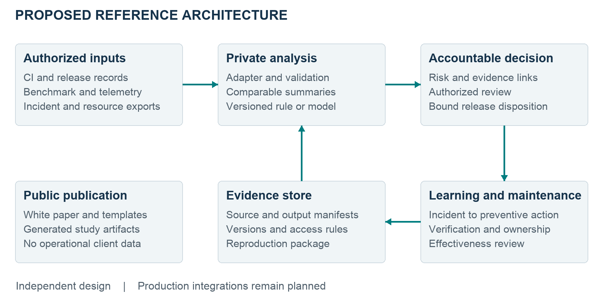
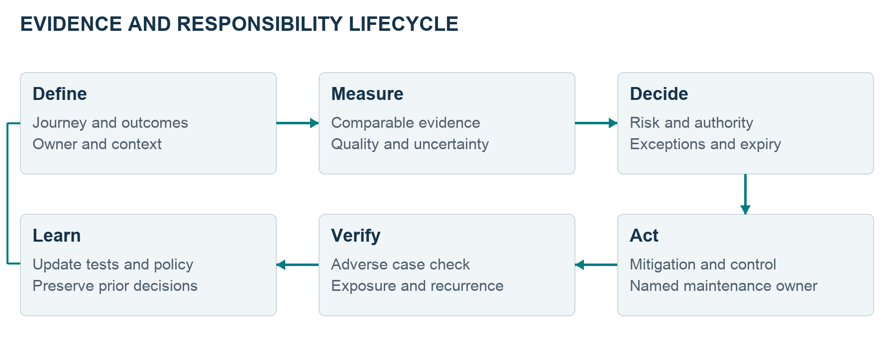
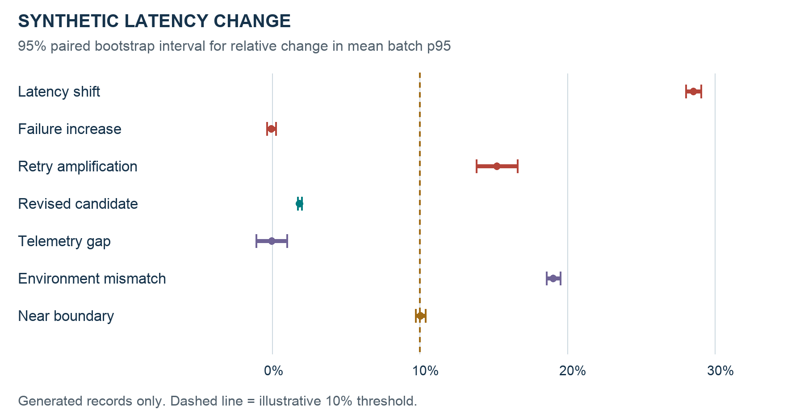
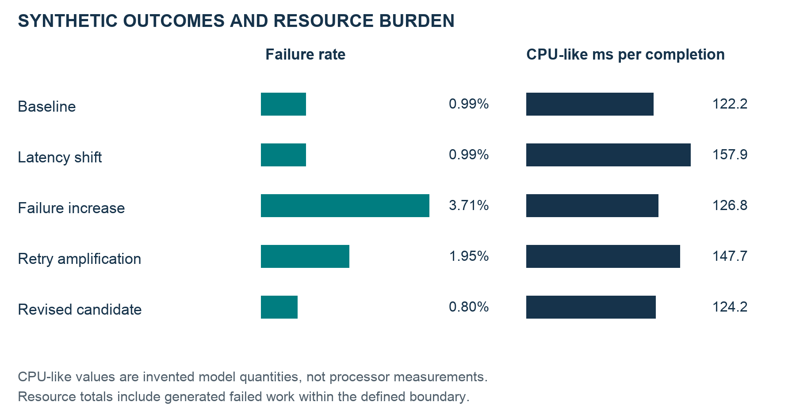
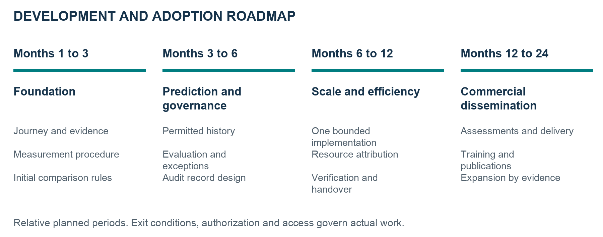
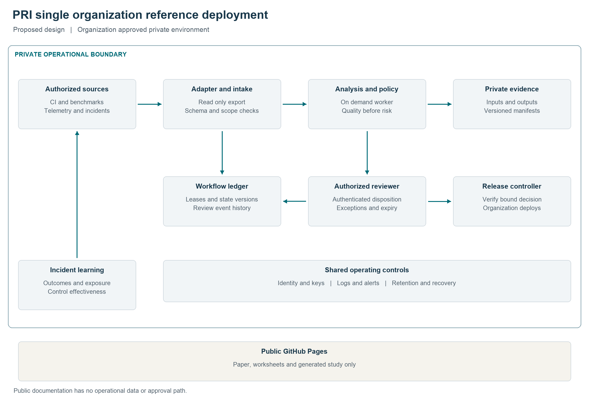

# Performance Risk Intelligence

## Technical and Business White Paper

Faruk Uslu  
Founder of PRI  
Version 1.2 public edition  
October 18 2026

## Executive summary

Performance Risk Intelligence (PRI) is a proposed framework and founder-led advisory practice for managing software performance as an operational risk. It connects standardized measurement, predictive release-risk assessment, accountable release controls, and compute and cost efficiency for mobile, voice-enabled, AI-enabled and cloud-backed services.

**The operating question is concrete.** What evidence should an organization require before promoting a change, who can accept the remaining risk, and how will an incident change the controls used next time? PRI connects a defined journey, comparable benchmarks, release context, risk ownership, a documented decision and follow-up verification. The intended result is a method a receiving team can understand and maintain.

Development begins with one team, journey or workload. Transparent measurement rules and human review provide the initial control. Predictive scoring requires a later, separately evaluated dataset and model. The original rollout progresses through foundation, prediction and governance, then scale and efficiency, with commercial dissemination beginning at Month 12. Planned services include assessments, implementation, training and recurring advisory support.

Faruk Uslu's background combines Amazon performance and release-governance responsibilities, operational-risk requirements work at the Central Bank of the Republic of Turkey, quantitative decision-support research and Genentech risk-assessment experience. Dated ORYS records identify him among the contacts and preparers. The background source guide identifies the original records and explains their relevance to PRI.

**Current maturity.** The public hub supplies documentation, worksheets and illustrations. This edition adds a detailed system design, including a proposed single-organization deployment and release-authorization protocol, alongside an executed analysis of generated data. Production adapters, operational approvals, predictive validation and customer outcomes remain implementation work. Prior employer achievements support preparation; they are distinct from independently developed PRI assets.

**The reproducible synthetic study** exercises latency degradation, increased failures, retry amplification, incomplete evidence, an environment mismatch and an uncertain boundary case. Code, parameters, batch summaries, checks and hashes accompany the results. These test the illustrative policy over generated observations; they do not benchmark a deployed service or estimate real-world detection accuracy.

Experts can use this paper to assess the design, examine background sources and revise a proposed opinion in their own terms. External research informs the engineering choices; it does not endorse PRI. Private employer documents, financial forecasts, draft letters and prospective-party identities remain outside the public edition.

## How to use this paper

Business and domain reviewers can start with Sections 1 through 4, then read the application patterns, delivery model and implementation roadmap. Engineers can continue through the measurement specification, architecture, data contracts, release policy and synthetic study. Appendix E brings these elements together as an implementation design, with component responsibilities, deployment boundaries, workflow semantics, capacity assumptions and acceptance criteria. Reviewers discussing Uslu's earlier work should consult Section 3 and Appendix A before citing a historical claim. Appendix B identifies external sources and the specific design question each informs.

For a letter or written assessment, record the edition and actual review date, the sections and artifacts examined, the reviewer's relevant expertise, and the basis for each conclusion. Reading this paper supports an assessment of its documented design. Firsthand statements about an employer project require the reviewer's own knowledge or access to the underlying authorized record. A generated example cannot corroborate a historical achievement.

The public edition omits personal addresses, private correspondence, underlying employer documents, private financial forecasts, draft letters and prospective-party identities. Amazon experience is summarized without dollar amounts or absolute operating metrics. The professional history uses the public name Faruk Uslu; supporting records may use Ahmed Faruk Uslu. This paper does not change ownership or licensing terms applicable to the public repository or third-party tools.

## Contents

1. The problem and intended contribution
2. Scope and the four pillars
3. Founder background and the experience behind PRI
4. Existing practice and research foundations
5. The measurement specification
6. Reference architecture and infrastructure
7. Evidence model and interface contracts
8. Release policy and decision workflow
9. Predictive release-risk development
10. Incident learning and control effectiveness
11. Compute cost and energy measurement
12. Reproducible synthetic study
13. Demonstration build specification
14. Application patterns across industries
15. Business delivery and adoption model
16. Implementation roadmap and responsibilities
17. Security privacy and operational risks
18. Validation agenda and limitations
19. Expert review and version stewardship
Appendix A. Background sources and citation guide
Appendix B. Research and technical references
Appendix C. Field dictionary and decision example
Appendix D. Demonstration acceptance checklist
Appendix E. Technical system design

## 1 The problem and intended contribution

### 1.1 A release decision spans technical and organizational boundaries

A software change may preserve functional correctness yet make a useful action slower, increase failures under load or consume more resources for the same completed work. The relevant change may be in application code, a model, a dependency, configuration, a feature flag or infrastructure. A user experiences the whole interaction; a release team often receives separate component dashboards, test reports and incident tickets.

A useful prevention process needs more than a threshold in a dashboard. The team must know whether the baseline and candidate are comparable, which outcomes were omitted, which conditions were represented and whether the evidence is current. It must assign responsibility for the decision and any exception. After an incident, the organization needs to verify that a preventive action was implemented and still works when the system changes.

PRI proposes a reusable specification for that chain of evidence and responsibility. Its intended contribution is the practical integration of measurement meaning, release context, decision authority and incident learning. The first implementation should test whether this structure makes decisions more reproducible and controls easier to maintain in a specific organization. Benefits remain hypotheses until evaluated.

### 1.2 The unit of value is completed work

A successful request that returns quickly is only one part of service quality. Failed requests may disappear from latency charts. A retry can improve the chance of completion while increasing workload. A voice service can report server availability while the first useful exchange arrives too late. A document-processing system can finish a computation but fail to deliver the usable result.

PRI therefore begins with a journey that has an agreed start, usable completion, timeout and outcome classification. It reports successful latency alongside all-attempt completion, failure and missingness. Compute and attributable cost use a defined functional unit, such as a completed document analysis, with failed work retained in the resource numerator.

### 1.3 A bounded route to broader usefulness

The direct application is local: improve the release-review method for one workflow. A broader route is possible when a software provider serves dependent organizations, and when generic methods can be learned and maintained by teams outside the first engagement. Neither route implies that an entire platform population benefits from every control. A credible account identifies the protected workflow, relevant exposure and evidence of actual use.

The dissemination program therefore measures publication, review, adoption, maintenance and outcomes separately. A white paper establishes availability. A completed training session establishes delivery. An independently maintained implementation provides different evidence. Demonstrated outcomes require their own measurements.

## 2 Scope and the four pillars

PRI retains the four-pillar scope described in the original endeavor and business plan. This paper specifies how those pillars could be implemented; it does not expand PRI into a general cybersecurity product, an enterprise risk platform or an AI model-safety certification service.

| Pillar | Intended function | Concrete implementation output |
| --- | --- | --- |
| Predictive regression prevention | Assess a release using permissible pre-release evidence and, later, evaluated predictive methods | Feature and label schema, scoring specification, evaluation report, decision criteria |
| Standardized measurement | Make journey comparisons interpretable across releases | Journey catalog, benchmark procedure, telemetry dictionary, comparison report |
| Performance risk governance | Connect findings to accountable decisions and durable controls | Risk and control records, exception workflow, decision history, recurrence review |
| Compute and cost efficiency | Investigate changed resource use for comparable completed work | Resource attribution report, efficiency indicators, qualified energy model |

### 2.1 What an initial implementation includes

The minimum useful scope is one journey, an explicit baseline, one candidate comparison, a small set of justified checks and a decision record. It includes unfavorable and incomplete results. It also includes an investigation path, an exception policy, a rollback responsibility and a handover procedure. The organization keeps authority over its own release.

A transparent rule can be useful before a trained predictor exists. However, a rule that flags an observed benchmark breach is a detection or decision mechanism; it is not evidence of predicting an unseen future release outcome. The framework keeps those capabilities distinct in both records and claims.

### 2.2 What requires a separate scope

A mobile device lab, production load testing, multiple customer environments, model training, regulated data processing, continuous on-call support and a hosted commercial portal each require additional resources and authorization. The initial design does not assume them. It also does not evaluate medical efficacy, autonomous driving safety, financial trading suitability or the correctness of a physical simulation merely because it measures a related software workflow.

### 2.3 Status terms

This paper uses **documented** for a specification or worksheet, **executed synthetic** for calculations run on generated inputs, **implemented** for working functionality in an identified environment, **evaluated** for results under a disclosed protocol, and **operational** for an adopted process with ongoing responsibility. These terms apply component by component. A working synthetic calculation does not upgrade an entire framework to production readiness.

## 3 Founder background and the experience behind PRI

### 3.1 A career connecting measurement with operating decisions

Faruk Uslu is the founder of PRI. His professional background combines software performance and release governance at Amazon with institutional operational-risk work at CBRT. He holds a Master of Science in Economics and Computer Science from Duke University and an Industrial Engineering bachelor's degree from TOBB University of Economics and Technology. The combination supports the proposed work across measurement design, quantitative analysis, process design and technical program execution. [H1]

The relevant experience is specific. At Amazon, his responsibilities have included latency-regression prevention, measurement stability, performance test reporting, real-user monitoring integration and the incorporation of test evidence into release review. At CBRT, the ORYS record concerns requirements for operational-risk records, roles, integrations, approvals and corrective actions. His branch-location research connects observed demand data to constrained optimization. His Genentech work involved structured assessment of operational threats with subject-matter participants. [H2-H6]

These activities explain the design orientation of PRI: define the observation, retain its limitations, give it an accountable operating decision and examine whether the response remains effective. They demonstrate relevant preparation rather than ownership of an already deployed independent PRI platform.

### 3.2 Amazon performance and release governance

Uslu's supplied professional record describes ownership of a latency-regression prevention program organized around improving measurement stability, earlier testing, enforceable criteria and targeted on-demand validation. The record also describes real-user monitoring integration and performance tracking. These experiences are relevant because benchmark quality, production context and release authority must work together before a test can influence an operating decision. [H2, H3]

The supplied professional statements report an approximately **40 percent reduction in landing-page latency** and an approximately **40 percent reduction in performance on-call workload** associated with the described programs. These are historical results reported in Uslu's supporting professional record; they are not independent PRI outcomes, guarantees or results reproduced by this paper. The public summary is limited to these attributed percentage improvements. [H2, H3]

A particularly relevant example is the On-Demand Latency Testing enhancement effort. The professional account identifies Uslu as Goal Owner and technical program manager and describes parallel test execution, a visual Go/No-Go report tied to service criteria, distribution of findings and inclusion of testing in Change Control Review. The transferable lesson is how evidence becomes part of a repeatable release process. This paper does not reproduce the employer implementation. [H2]

Uslu also worked with QA leadership on pipeline promotion latency testing intended to detect latency increases introduced by code changes. That collaboration informs the distinction between producing a performance measurement and making it usable for a team reviewing promotion. This account is provided by Uslu; it does not represent a separate statement from the QA counterpart. [H7]

Cost-optimization experience informs PRI's efficiency pillar. Different supplied materials describe proposed optimization and reported results with different scopes. This edition therefore makes no numerical public claim about employer cost savings. The useful design principle is to assess resource changes together with service-quality guardrails, then distinguish a proposal from an executed and verified outcome. [H2, H3]

### 3.3 ORYS at the Central Bank of the Republic of Turkey

ORYS is the Operational Risk Management System described in the CBRT requirements-analysis record. The supplied English translation identifies Ahmed Faruk Uslu among the requesting unit's contacts and among the preparers or modifiers of versions dated February 19 and March 11, 2019. The record supports his participation in this requirements effort alongside other contributors. It does not establish sole authorship of the system. [H4]

The requirements cover structured risk and incident information, process context, roles and permissions, action plans, reporting and approval workflows. The integration section specifies the relationship with email, organizational information and identity services. These features illustrate the work of making responsibility operational: records need an owner, routing needs an authority model, and a decision needs accessible context. [H4]

The incident workflow contains an instructive condition. When additional preventive measures are planned, a designated approval requires the linked action plans to have Active status. This is a condition in a requirements document. Active status is not equivalent to completed work or demonstrated effectiveness. In PRI, that distinction motivates separate states for a proposed action, implementation evidence, verification and a later effectiveness review. [H4]

The transferable experience is the specification of connected records and decision conditions. PRI would develop its own generic schema, policy and workflows using authorized local inputs. No CBRT database, internal endpoint, screenshot, role matrix or source document is distributed with the public paper. The historical requirements support participation and design context; actual deployment dates and quantified institutional outcomes would require separate evidence.

### 3.4 Quantitative research on branch location decisions

Uslu authored a specialist proficiency thesis titled *A Multi-Criteria Decision Support Model for Optimal Province Selection for Central Bank Branches*. The supplied thesis abstract describes province-level panel data for 2010 through 2017, estimation of banknote transaction volumes and a mixed-integer model with distance constraints. It reports 270 models across ten branch-network alternatives, with solutions computed using CPLEX. [H5]

This is relevant preparation for specifying a decision problem, documenting assumptions, constructing an empirical input and evaluating constrained alternatives. The optimization task is different from software-regression prediction. It does not establish that a PRI classifier exists or performs well. Its relevance is methodological discipline, not transfer of a measured accuracy result from one field to another.

The thesis source and committee documents are held in the private professional record. Appendix A identifies the original documents and the relevant sections for authorized review. This paper supplies a concise background summary rather than republishing the thesis or its underlying institutional data.

### 3.5 Genentech and additional professional preparation

During a Risk and Data Management internship at Genentech in 2021, Uslu contributed to structured risk-assessment work involving operational threats, workshops with subject-matter experts and prioritization of responses. A supplied supervisory statement describes this work. Its relevance to PRI is the practical need to define a risk with the people responsible for the operation and connect analysis to a feasible response. This is professional evidence of relevant experience, not a clinical or software validation claim. [H6]

Uslu's earlier work also includes project management, a renewable-energy initiative and international operational-risk engagement. CBRT assigned him to the 2018 International Operational Risk Working Group conference in Singapore, after which he prepared a report on operational-risk practices. A subsequent assignment records his planned participation in the 2019 IORWG conference in Santiago, Chile. His conference report addresses emerging risks, risk assessment, control testing and incident information, providing practical context for PRI's governance and incident-learning design. [H8]

His preparation includes industrial engineering, graduate quantitative and computing study, cloud architecture training, process-improvement methods and operational-risk learning. This background describes relevant training rather than asserting a current regulated professional license or product certification. [H1]

### 3.6 Independence and intellectual property

PRI is separately developed from Uslu's employer work. Historical examples explain his experience; they do not supply employer code, data, architectures or reusable proprietary procedures. The reference architecture, schemas and simulation in this edition are proposed independent designs. A potential internal employer project and an external PRI engagement would require their own scope and ownership arrangements. Neither automatically grants rights to reuse the other's implementation.

## 4 Existing practice and research foundations

### 4.1 Measurement uncertainty is part of the result

Kalibera and Jones' work on rigorous benchmarking emphasizes uncertainty and the different levels at which repeated measurements vary. The design implication for PRI is to record the experimental unit, repeat across meaningful independent runs and report uncertainty with effect size. Merely increasing the number of requests inside a single run does not resolve between-run or between-environment variation. [R1]

ServiceLab, described by Chow and colleagues at OSDI 2024, is a concrete example of pre-production performance-regression testing at scale. Its discussion of noisy environments and statistical analysis shows that preventive testing is established engineering practice. PRI should learn from that experience and evaluate its own bounded implementation rather than claim to have invented performance prevention. No ServiceLab result is attributed to PRI. [R2]

Dean and Barroso's *The Tail at Scale* explains why latency distributions matter in distributed interactive systems. For PRI, this supports examining tail behavior alongside typical response and completion. It does not justify copying a universal latency target into every application. [R3]

### 4.2 Release safety already includes preventive mechanisms

Google's canarying guidance describes comparing a limited candidate deployment with a control before wider rollout. Its error-budget example connects reliability policy with release decisions. These are existing approaches PRI can integrate with. A pre-release benchmark and a canary answer different questions: the first examines a controlled environment, while the second observes limited production exposure. Neither eliminates the need for the other. [R4, R5]

Grafana k6 already supports metric thresholds that produce pass or fail results. Kayenta provides an automated-canary reference; its older standalone repository points to the current Spinnaker monorepo. These capabilities mean that PRI's case should focus on the usefulness of its evidence contracts, ownership and follow-through in a local implementation. Feature exclusivity is not assumed. [R6, R7]

### 4.3 Governance and change management

The Basel Committee's operational-risk principles connect risk management with change management, defined responsibilities and ICT controls. NIST SP 800-53 includes configuration change control and associated testing and records. PRI uses these as conceptual references for decisions, ownership and retained evidence. A design comparison does not certify compliance or make banking guidance apply to every adopter. [R8, R9]

NIST AI RMF 1.0 organizes AI risk management around Govern, Map, Measure and Manage. NIST CSF 2.0 uses six functions including Govern. This paper keeps those frameworks and versions distinct. PRI's performance scope can support some relevant practices; it does not cover the full set of AI or cybersecurity risks. [R10, R11]

### 4.4 Predictive components require their own evidence

Breck and colleagues' *The ML Test Score* and Sculley and colleagues' work on ML technical debt highlight data, testing, monitoring and system dependencies around a model. They motivate a modest predictive implementation with explicit provenance, time boundaries, baselines and maintenance responsibility. They do not supply a score or readiness certification for PRI. [R12, R13]

Liao and colleagues describe early detection by connecting local performance information with architectural models. The inspected 2024 arXiv version offers a research approach to the component-versus-system tradeoff. PRI does not implement that method in this edition; it provides a useful comparison for evaluating whether a local signal represents the full journey. [R14]

NIST's 2026 monitoring report discusses challenges in monitoring deployed AI systems. Its relevance here is the need to preserve context and acknowledge monitoring limitations. PRI's resource and release measurements remain complementary to separate evaluations of answer quality, safety and fairness. [R15]

### 4.5 Telemetry and efficiency

OpenTelemetry's HTTP conventions supply useful standardized duration and error concepts. Its guidance on sensitive data reinforces minimizing and sanitizing telemetry. PRI adds local journey meaning, release linkage and evidence-quality checks; matching metric names alone does not make two workloads comparable. [R16, R17]

FinOps unit economics supplies a reference for relating technology cost to a meaningful unit of value. The Software Carbon Intensity specification makes system boundaries and functional units important to an emissions calculation. This paper separates resource consumption, monetary allocation, modeled electricity and emissions rather than converting one into another without the required inputs. [R18, R19]

### 4.6 Questions the first implementation must answer

The research supports the underlying problem and offers mature techniques. The remaining PRI-specific questions are practical: Can a receiving team reproduce the comparison? Does evidence quality prevent misleading approvals? Can an exception be traced and expire correctly? Does an incident result in a maintained control? Can another team use the common contract with a different adapter? These questions define the validation program in Section 18.

## 5 The measurement specification

### 5.1 Define a journey before choosing a dashboard

A journey record identifies the action, business purpose, owner, start event, usable completion event and deadline. It lists included stages, dependencies and explicit exclusions. It also defines success, technical failure, timeout, user cancellation, non-answer where relevant and unresolved outcome. Mutually exclusive final outcomes should reconcile to the eligible-attempt denominator.

For example, a hypothetical coaching journey begins when a defined event is available for analysis and ends when an actionable prompt becomes visible. A document-processing journey begins at accepted submission and ends when a usable analysis can be retrieved. The definition must make clear whether upload, queue delay, authentication and delivery are included. A benchmark cannot silently change those boundaries between releases.

The minimum comparison context includes workload fixture version, input-size class, software and model versions, dependency and configuration versions, resource allocation, concurrency, network profile, cache state, warm-up policy and observation interval. A mobile comparison additionally records device class, OS version and relevant device state. Source timestamps and clock domain must be known before subtracting events from different services.

### 5.2 Separate measurement clocks and outcomes

Elapsed duration within one process should use a monotonic clock. Cross-process traces need clock synchronization, propagation and validation. A browser-visible completion may be later than the server response. A voice response metric should specify end of recipient utterance and beginning of audible output rather than an internal completion timestamp. A failed interaction receives its own outcome; it is not dropped merely because no normal completion duration exists.

A report includes p50 and p90 or p95 for successful attempts, with the quantile definition and sample count. It also includes all-attempt completion, failures, timeouts, missing outcomes and the share completed within the useful window. If fewer than the expected outcomes are observed, the report says so. The operational policy decides whether that missingness prevents evaluation.

### 5.3 Design the experiment around the expected effect

The team first specifies a practically material change: an absolute service-objective breach, a relative degradation or a failure increase worth acting on. A pilot run estimates variation and indicates how much independent repetition is needed. The test plan identifies which observations are independent and which share a device, worker, deployment, run or workload fixture.

Where feasible, interleave baseline and candidate runs, randomize their order and retain a contemporaneous control. Use the same authorized workload and record changes rather than assuming a fixed environment. Warm-up and cache treatment should reflect the target use case; cold-start behavior can be a separate segment. Repeatedly tuning a threshold after inspecting candidate results undermines its interpretation.

The synthetic study in Section 12 uses paired batches with common generated random draws for instructional clarity. A real benchmark needs an appropriate experimental design of its own. Autocorrelation, bursty traffic, shared dependencies and variation between machines can make a request-level bootstrap misleading. The analysis should match the independent unit and disclose its assumptions.

### 5.4 Quality checks precede risk interpretation

Before applying a threshold, validate schemas, identifiers, units, expected counts, deduplication, clock plausibility and source freshness. Verify baseline and candidate environment fingerprints and fixture versions. Check segment coverage: a healthy aggregate can conceal a worse low-end device or a failed input-size class.

Suggested initial evidence states are valid, incomplete, stale, incomparable and invalid. The policy can withhold promotion when required evidence is missing. It should not translate missing observations into zero failures or favorable performance. Diagnostic summaries may still be useful, provided they carry the evidence state and cannot be mistaken for an approval.

### 5.5 The comparison report

A comparison report should let another engineer answer five questions: what changed, what was measured, what conditions were held comparable, what uncertainty remains and what decision follows. It includes the baseline and candidate identifiers, outcome counts, relevant quantiles, effect sizes, uncertainty, policy version, quality flags and links to permitted underlying artifacts.

The report also records alternative explanations, such as different input mix, load, hardware, model service behavior or provider incidents. A benchmark breach establishes an observation under its protocol. Causal attribution requires additional investigation. Production telemetry can test representativeness after a controlled comparison; it must not be used retroactively as a pre-release feature if it was unavailable at decision time.

## 6 Reference architecture and infrastructure

### 6.1 Start with a small evidence-processing system

The initial architecture is a batch-oriented toolchain operated by the founder in an isolated development environment. It reads authorized exports, validates them, produces comparison summaries and writes reviewable reports. A command-line process and versioned files are sufficient for early development. A public API, shared customer database and continuously running cluster are not initial prerequisites.

Figure 1. Proposed architecture. The public website is a separate publication surface. The adapters, evidence store and operational decisions belong in an authorized private environment. Only the synthetic analysis subset is executed in this edition.

A practical module boundary is **collect, validate, summarize, assess, record and learn**. Collection knows how a local tool exports data. Validation enforces the shared contract. Summarization produces metrics with quality context. Assessment applies the approved rule or evaluated model. Recording captures a decision and authorization separately. Learning links later incidents and control reviews without silently rewriting the original assessment.

### 6.2 Three deployment levels

| Level | Suitable use | Proposed components | Readiness condition |
| --- | --- | --- | --- |
| Local development | Generated examples and contract development | Personal workstation, isolated Python environment, Git, JSON and CSV artifacts | Reproduction and artifact-integrity checks |
| Single-organization sandbox | One agreed journey and adapter | Client-approved runner, private object storage, restricted logs, optional metadata database | Access approval, integration tests, restore and rollback tests |
| Expanded operational use | Additional workflows after evaluation | Repeatable deployment configuration, stronger service operations and identity integration | Owner acceptance, support capacity, security review and measured need |

The local workstation is the initial development resource. Device or operating-system benchmarks must run on representative targets; a developer laptop alone does not establish Android, iOS or production cloud performance. A separate test runner prevents the reporting tool's own execution from contaminating service measurements.

### 6.3 An illustrative AWS sandbox

An AWS implementation could use an isolated account or tightly scoped project boundary; IAM roles for the runner and reviewers; private encrypted object storage for evidence; an on-demand container task for validation and analysis; and centralized operational logs. Scheduled or event-triggered batch execution can be added when manual runs become repetitive. A small metadata database is optional once file-based indexing becomes hard to maintain.

S3 can hold versioned evidence objects protected against routine overwrite and report outputs, with public access disabled and lifecycle retention selected for the approved data class. An ECS task or another short-lived compute mechanism can process evidence without leaving a permanent service running. CloudWatch can retain execution logs, while CloudTrail records relevant account activity. Specific services are examples, not required dependencies or a statement that this environment has been provisioned.

If a workflow uses GitHub Actions to access AWS, federated OIDC with narrowly scoped role trust can avoid storing a long-lived cloud credential in the repository. Pin the permitted repository, branch or environment and constrain role permissions. GitHub and AWS documentation describe this identity mechanism; it still requires careful local configuration and validation. [R20, R21]

### 6.4 Trust boundaries

The source organization owns access to its operational systems and data. An adapter should initially receive a least-privilege export or read-only view. The analysis process should not need a production deployment credential. A release controller can consume a bound decision result through a separate, restricted integration. Public GitHub Pages hosts only approved static resources and generated demonstrations; it does not collect client telemetry or hold operational approvals.

Separating boundaries prevents a public documentation change from becoming a production authorization. The same separation supports portability: another organization can supply a new adapter without sharing customer data or adopting a hosted PRI platform. Single-organization isolation is the default development assumption. Multi-tenant storage and cross-customer learning require a separate design and data-rights review.

### 6.5 Evidence retention and reproducibility

Each analysis run should preserve an input manifest, source and configuration hashes, tool version, environment fingerprint, policy version and output hashes. The evidence package should identify its data class and permitted recipients. A reproducible calculation requires more than a timestamp: another authorized reviewer needs the exact inputs, code, configuration and documented method.

Content hashes detect changes relative to a known manifest; they do not prove who authored an artifact or when the underlying event occurred. Append-only records and object versioning improve traceability but are not automatically tamperproof. Stronger integrity may require authenticated writers, protected storage, retention controls and an independently preserved copy or trusted signing process.

### 6.6 Reliability of the PRI implementation

An unavailable or malformed analysis result should lead to an explicit unavailable-evidence state. Retries of the same job use a stable run identifier and must not create duplicate approvals. A partial write uses a staging object and a completion manifest. Recovery exercises should restore a prior report and reproduce its interpretation without silently mixing policy versions.

The sandbox owner defines recovery expectations appropriate to a batch tool. A proposed initial recovery objective might be restoration of the latest accepted configuration and evidence from a protected backup within one working day. This is a design target to test, not a current service commitment. Stricter availability or support commitments need a separate operating arrangement.

## 7 Evidence model and interface contracts

### 7.1 Preserve a connected chain of records

The core entities are Journey, Release, Environment, Benchmark Run, Observation Summary, Risk, Control, Decision, Exception, Incident and Effectiveness Review. Each has a stable identifier, schema version, creator or source, observation time, recording time and links to related records. A source reference carries a content hash where available and an access classification.

Figure 2. A finding becomes a decision through explicit ownership. Later observations add evidence and control reviews; they do not change what was known at the original decision time.

| Record | Minimum fields | Important constraint |
| --- | --- | --- |
| Journey | ID, version, start, usable end, outcomes, owner, fixture | Boundaries change through versioning |
| Release | ID, artifact digest, commit, configuration and model versions, decision time | Do not identify a release by display name alone |
| Benchmark | Run ID, journey version, environment fingerprint, source interval, counts and metrics | Preserve all-attempt outcomes and exclusions |
| Risk | ID, exposure, observations, hypotheses, severity rationale, owner | Keep suspected cause separate from confirmed cause |
| Control | ID, linked risks, procedure or test, owner, implementation and verification | Existence does not establish effectiveness |
| Decision | ID, release digest, policy, evidence manifest, disposition, authority and time | Bound to exact candidate and evidence |
| Exception | ID, affected check, residual risk, approver, conditions and expiry | Expiry or scope change requires reevaluation |
| Incident | ID, occurrence and detection times, affected release, impact, attribution status | Do not treat absence of a report as a negative label automatically |

### 7.2 Observation summaries and raw evidence

A summary retains numerator and denominator alongside each rate. It records latency units and quantile definitions; source sample counts; retry and resource boundaries; segment keys; uncertainty method; exclusions; and missing or late data. Storing only a p95 value loses the context needed for review. For real telemetry, retain an authorized histogram or a permitted raw extract sufficient to reproduce the calculation where feasible.

Events need both occurrence time and availability time. A delayed incident report may describe an earlier event yet become known only after the release decision. That distinction matters to later predictive evaluation. Historical decisions remain associated with the evidence available when they were made.

### 7.3 Adapter contract

The adapter's output is a versioned evidence bundle containing a manifest, release and journey identifiers, environment description, summary records and authorized evidence references. It returns validation findings rather than silently coercing bad units or missing values. Reject unknown fields in the decision-bearing core schema. A separately declared extensions object may retain approved, namespaced metadata after classification checks. Missing or incompatible mandatory fields fail validation.

An initial adapter may read a CSV exported by an existing tool. A later one can query telemetry or CI interfaces with organization-approved credentials. Adapter tests include missing release IDs, duplicate runs, wrong units, impossible counts, late records, absent segments and changed fixture versions. Data ownership and access remain local. Appendix C gives a compact field dictionary and a decision example.

### 7.4 Assessment result versus authorization

An assessment function consumes validated summaries and a versioned policy and returns findings, reason codes, quality status and a proposed disposition. It should be deterministic for fixed inputs when using rules. A future model result also records model version, feature snapshot and its applicability checks.

Authorization is a separate operation. The organization verifies the designated reviewer and approval conditions, then records the authorized disposition. A pipeline must check that the decision's release digest, journey scope and evidence hashes match the candidate being promoted. Otherwise a valid result from an earlier candidate could be replayed against a changed artifact.

### 7.5 An interface that can remain small

The first implementation can expose file-based commands such as validate evidence, compare releases and produce report. These are proposed command roles rather than implemented APIs in this edition. The accompanying executable is only the synthetic study. If later integration needs an API, use authenticated requests, idempotency keys, authorization checks and stable result states. Implement a minimal interface only when the actual adopter requires it.

## 8 Release policy and decision workflow

### 8.1 Policy is an operating agreement

The organization defines its service objective, material-regression threshold, required evidence, review authority and exception rules. The policy version records the basis for these choices. For one workflow, a latency increase may be acceptable if a significant function is added; for another, an absolute deadline may dominate. A universal PRI score cannot resolve that tradeoff without local context.

The illustrative study uses a 10 percent relative latency threshold and a one-percentage-point failure threshold. Those values are generated-example policy choices. They are not published service objectives, industry standards or promises about a particular candidate organization.

### 8.2 Evaluate in a deliberate order

First check whether the evidence is usable. If required coverage, comparability or freshness is missing, retain a data-related hold. Next assess hard requirements and observed breaches. Then interpret uncertainty and unresolved risks. Finally identify the authorized disposition and any exception conditions. A predictive score cannot override a known failed hard requirement merely because its overall score is favorable.

Useful states are **Hold for evidence**, **Hold for regression**, **Investigate**, **Eligible for release review**, **Approved with conditions**, **Approved**, **Rejected**, **Expired** and **Superseded**. The first four can be analysis outputs; approval states require organizational authority. The synthetic executable emits only analysis states and never grants production approval.

### 8.3 Uncertainty and practical significance

A confidence interval describes uncertainty under the stated sampling assumptions. It is not a probability that the candidate is safe. If a material degradation interval lies above the permitted threshold, a hold can be appropriate. If the interval crosses the threshold, further evidence or a documented judgment is needed. Favorable evidence for selected metrics does not establish every untested requirement.

The initial experiment should predefine primary metrics and required segments. Monitoring many metrics and repeatedly checking results increases the chance of misleading findings. A production implementation should define multiplicity treatment and sequential-monitoring rules, or clearly treat exploratory signals as investigation prompts. The synthetic study does not implement a general multiple-testing correction.

### 8.4 Exceptions with accountable residual risk

An exception identifies the specific failed requirement and the evidence supporting a temporary decision. It names the approver, affected release and journey, compensating controls, exposure limit, rollback conditions, follow-up owner and expiry. It cannot silently waive authentication, legal obligations or all missing evidence. The organization defines which conditions are non-waivable.

An expired exception requires a new decision; copying a prior approval is insufficient. A modified candidate also requires reevaluation against its bound scope. Approval should not be possible by the same identity where separation of duties is required. The initial demonstration can model these cases; a real workflow needs identity-backed authorization and execution records.

### 8.5 Shadow operation before enforcement

Begin in advisory mode: report findings and compare them with actual engineering review. Investigate noisy checks, coverage gaps and operational burden. Move to enforced gates only after the owner accepts the policy and verifies failure behavior, bypass controls and rollback. Retain an emergency procedure with limited authority, time bounds and a subsequent review.

The evaluation should include the cost of unnecessary holds and investigation time, not only detected regressions. A control that produces frequent unexplained holds may be bypassed and become ineffective. Transparent reasons, consistent evidence and maintenance ownership are therefore part of technical feasibility.

## 9 Predictive release risk development

### 9.1 Define the prediction task before collecting labels

A prospective model asks whether a defined release will cause an agreed harmful outcome within an observation window for a specified journey. The prediction timestamp and eligible inputs must be explicit. Post-release outcomes may become labels but cannot be included as if they were known before the decision. Canary evidence belongs to a later decision point than a pre-merge prediction.

Candidate features include authorized change metadata, dependency and configuration changes, historical ownership context, controlled benchmark deltas and evidence-quality indicators. Sensitive code content and personnel judgments are unnecessary defaults. The first dataset should minimize features and record why each is expected to help.

### 9.2 Label construction and uncertainty

Each label records the outcome definition, exposure, observation window, incident linkage, attribution confidence and adjudicator. A release with no reported incident may have limited exposure or incomplete monitoring. Distinguish confirmed harmful, adequately observed non-harmful, inconclusive and censored observations. Do not force every uncertain case into a clean negative label.

Multiple tickets can describe one incident, and one change can produce multiple releases. Group correlated records to avoid training and test contamination. Retain unresolved cause separately from observed harm. An intervention that blocks a release also changes which outcomes can be observed; the evaluation must account for that selection instead of assuming withheld changes were harmless.

### 9.3 Baselines and evaluation

Start with an interpretable rule and an appropriate simple baseline. A candidate model might be regularized logistic regression or a modest tree-based classifier if data supports it. A complex model is not an automatic improvement. The development team should justify the sample and event count relative to feature complexity, imbalance and desired uncertainty rather than announce an arbitrary universal minimum.

Use chronological training, validation and later-release test sets. Group related incidents and changes. Report class prevalence, precision, recall, false-positive and false-negative counts, PR-AUC where useful, and uncertainty. If probabilities drive decisions, evaluate calibration with reliability plots and an appropriate scoring rule. Report performance by relevant workflow and environment segments when counts permit.

Select thresholds using the validation set and explicit costs of missed harmful changes and unnecessary holds. Preserve the later test set. Compare against the existing process where an ethical, feasible protocol permits. No model-accuracy number, learned artifact or predictive validation result is asserted in this edition.

### 9.4 Deployment and maintenance

A model first runs in shadow mode. Record its recommendations, feature completeness, unknown contexts and disagreement with the approved policy. Review drift after major workload or architecture changes. Version the dataset, features, training code and decision threshold together. Define a rollback to the transparent rule when model inputs fail applicability checks or the model is unavailable.

A model card should state the prediction point, target, training scope, allowed uses, excluded contexts, evaluation results and limitations. Human review remains available for consequential cases. Performance evidence may support a risk assessment; it does not eliminate organizational responsibility for the release.

## 10 Incident learning and control effectiveness

### 10.1 Keep incident observation separate from explanation

An incident record describes the affected journey, occurrence and detection times, observed impact, relevant releases and investigation state. It can retain a suspected timeout or retry change without asserting proven causation. Later evidence may strengthen or reject the hypothesis. The original record remains available so that reviewers can see the development of the explanation.

The review asks what prevented detection or mitigation: an absent scenario, a poor boundary, insufficient load, missing telemetry, ineffective ownership, an expired exception or an untested recovery path. These categories help convert an incident into a specific action rather than a general instruction to be more careful.

### 10.2 A control has a lifecycle

A proposed control names its risk, intended behavior, owner, implementation location and evidence needed to verify it. Implementation creates the actual test or procedure. Verification checks that it behaves correctly against a known adverse case and a suitable non-adverse comparison. Effectiveness review examines its behavior over real exposure and maintenance.

Keep the states proposed, implemented, verified, operationally observed, revised and retired distinct. Completion of a ticket does not establish successful prevention. A check that once detected an issue may later become obsolete when the architecture, fixture or metric changes.

### 10.3 Recurrence needs a denominator and an observation window

Define recurrence using an agreed failure mechanism or risk class, not merely similar incident titles. Track relevant releases, operating hours, traffic or completed work exposed to the control. Report the observation period and monitoring coverage. A short incident-free interval can reflect low exposure, reporting gaps or chance; it is not proof that the control caused an improvement.

A monthly control review can inspect missing evidence, overdue actions, exception age, bypasses, false holds and repeated mechanisms. A quarterly review can assess whether the policy still matches the service objective. These are proposed review cadences to adapt with the adopting team.

## 11 Compute cost and energy measurement

### 11.1 Define the functional unit and include unsuccessful work

The first efficiency report should use an agreed unit such as a completed analysis or a completed first voice exchange. Collect attributable CPU or accelerator time, retries, processing attempts, transfer volume and relevant resource allocations. Divide resource totals, including failed work within the boundary, by successful completed units. Also report offered workload and completion so that less work is not mistaken for more efficiency.

Latency is elapsed time, not processor consumption. A request can wait on a queue with little CPU or complete quickly using greater parallel capacity. A lower bill can reflect a discount, traffic loss or allocation change. Cost and resource data therefore need their own sources and an explanation of fixed versus variable costs.

### 11.2 Attribution and net value

Compare similar inputs, output-quality requirements, resource class, concurrency and operating conditions. Record price changes and shared-cost allocation. An initial analysis can report measured resource differences before it can credibly estimate a monetary effect. Attribute a saving only when the evidence supports the link between a change and the relevant cost boundary.

Net value must account for instrumentation, test execution, storage, investigation, maintenance and delivery effort. A control that reduces repeated failures may still require more testing resources. Report both sides. This public edition contains no private business forecast, employer dollar amounts, customer savings calculation or ROI promise.

### 11.3 Modeled electricity and emissions

A later energy model can use measured resource activity with documented hardware or provider factors and a defined facility boundary. If a factor already includes facility overhead, applying an additional multiplier would double count it. Hardware, utilization, geography, time and attribution can materially affect interpretation. Use sensitivity ranges and identify which inputs are measured, estimated or assumed.

Electricity and emissions are separate outputs. Emissions additionally require appropriate intensity factors and a clearly stated accounting approach; embodied impacts need their own treatment. The synthetic study generates CPU-like values but performs no energy conversion. It cannot demonstrate electricity savings or emissions reductions. [R19]

## 12 Reproducible synthetic study

### 12.1 Purpose and execution status

This edition includes an executed Python reference analysis of generated observations. It demonstrates the handoff from comparable summaries to an explicit analysis disposition. No application, cloud service, mobile device or customer system was performance-tested to produce these numbers. The simulated latency, failures, retries and CPU-like activity are created by the generator; the calculations over them were actually run during preparation of this edition.

The study is separate from the website's earlier invented five-run worked example. Its values do not reproduce that example and should not replace its provenance. Both are instructional, with different inputs. A citation should identify which example was examined.

### 12.2 Generated inputs and sampling assumptions

The generator uses seed 20261017, 20 batches and 500 eligible attempts per batch for each of nine scenarios, producing 90,000 generated observations. Successful base duration follows a lognormal distribution with log-median corresponding to 450 milliseconds and log-scale standard deviation 0.30, multiplied by a generated batch factor with log-scale standard deviation 0.035. A retry adds 250 milliseconds of elapsed time. Failed attempts receive a synthetic timeout of 2,000 milliseconds and remain outside successful-latency quantiles.

CPU-like activity is an independent defined quantity: one quarter of scaled base duration, plus 90 milliseconds for a retry and 40 milliseconds for a failed attempt. These coefficients are invented for the model, not empirical relationships. Each scenario specifies failure probability, retry probability, coverage, environment identity and duration scale. All scenarios reuse the random stream, making the comparisons paired. The neutral scenario is consequently identical to the baseline by construction; its zero uncertainty is not an empirical demonstration of zero false positives.

The analysis computes pooled successful-attempt p50 and p95 as descriptive summaries. For policy comparisons, it resamples the 20 paired batch summaries 2,000 times and estimates the relative change in the mean of batch p95 values and the observed failure-rate difference. The displayed interval is the central 95 percent of those bootstrap estimates. It is not an interval for pooled p95, proof of causation, a tolerance interval or a guarantee for future traffic.

Table of generating parameters. Every setting is an illustrative assumption. Failure and retry columns are generating probabilities, distinct from observed frequencies.

| Scenario | Duration scale | Failure probability | Retry probability | Coverage probability | Environment |
| --- | --- | --- | --- | --- | --- |
| baseline | 1.000 | 0.010 | 0.03 | 1.00 | E1 |
| neutral | 1.000 | 0.010 | 0.03 | 1.00 | E1 |
| latency shift | 1.300 | 0.010 | 0.03 | 1.00 | E1 |
| failure increase | 1.000 | 0.040 | 0.03 | 1.00 | E1 |
| retry amplification | 1.000 | 0.020 | 0.30 | 1.00 | E1 |
| revised candidate | 1.020 | 0.008 | 0.03 | 1.00 | E1 |
| telemetry gap | 1.000 | 0.010 | 0.03 | 0.70 | E1 |
| environment mismatch | 1.200 | 0.010 | 0.03 | 1.00 | E2 |
| near boundary | 1.107 | 0.010 | 0.03 | 1.00 | E1 |

### 12.3 Illustrative policy

Evidence coverage below 99 percent or a mismatched environment produces Hold for evidence before any favorable performance disposition. For otherwise valid evidence, a lower interval bound above 10 percent relative latency degradation or above one percentage point failure increase produces Hold for regression. If both upper bounds are at or below the respective limits, the result is Eligible for release review. Remaining cases produce Investigate. A favorable result covers these checks only and grants no production approval.

### 12.4 Calculated results

All values in Tables 1 and 2 and Figures 3 and 4 are synthetic. Counts, rates and intervals below are generated directly from the accompanying result JSON rather than manually entered estimates.

Table 1. Generated evidence and analysis disposition.

| Scenario | Observed attempts | Failure percent | Successful p95 ms | Analysis disposition |
| --- | --- | --- | --- | --- |
| Baseline | 10,000 | 0.99 | 761.2 | Eligible for review |
| Neutral paired control | 10,000 | 0.99 | 761.2 | Eligible for review |
| Latency shift | 10,000 | 0.99 | 977.2 | Hold for regression |
| Failure increase | 10,000 | 3.71 | 760.2 | Hold for regression |
| Retry amplification | 10,000 | 1.95 | 869.1 | Hold for regression |
| Revised candidate | 10,000 | 0.80 | 775.5 | Eligible for review |
| Telemetry gap | 6,970 | 0.95 | 759.6 | Hold for evidence |
| Environment mismatch | 10,000 | 0.99 | 904.4 | Hold for evidence |
| Near boundary | 10,000 | 0.99 | 838.1 | Investigate |

Table 2. Paired bootstrap intervals. Latency is relative change in mean batch p95; failure is an absolute percentage-point difference from the baseline.

| Scenario | Latency interval percent | Failure interval percentage points | Coverage percent |
| --- | --- | --- | --- |
| Latency shift | 28.01 to 29.04 | 0.00 to 0.00 | 100.0 |
| Failure increase | -0.35 to 0.26 | 2.49 to 2.93 | 100.0 |
| Retry amplification | 13.82 to 16.61 | 0.81 to 1.11 | 100.0 |
| Revised candidate | 1.73 to 2.00 | -0.25 to -0.13 | 100.0 |
| Telemetry gap | -1.07 to 1.02 | -0.16 to 0.08 | 69.7 |
| Environment mismatch | 18.58 to 19.52 | 0.00 to 0.00 | 100.0 |
| Near boundary | 9.72 to 10.38 | 0.00 to 0.00 | 100.0 |

Figure 3. Generated paired-batch latency intervals. The dashed line is the illustrative 10 percent policy boundary. The environment-mismatch interval remains diagnostically visible but cannot establish a comparable release effect.

Figure 4. Generated failure rates and CPU-like activity per completion. All resource values are defined model quantities, not measurements of actual processors or energy.

### 12.5 What the scenarios teach

The latency-shift case breaches the illustrative latency criterion. The failure-increase case has nearly unchanged successful-attempt latency but a materially higher failure rate; a latency-only view would miss the problem. Retry amplification increases the generated resource burden as well as latency. The revised candidate satisfies the selected comparison checks but still needs all other release requirements and authorized review.

The telemetry-gap case appears favorable among observed attempts but lacks the required coverage. Its diagnostic rates use observed attempts and cannot describe the missing population. The environment-mismatch case changes the environment marker and generated duration; it is held because attribution to the candidate is not supported by a comparable setup. The near-boundary case produces an interval that crosses the latency limit, requiring investigation rather than a forced favorable or unfavorable classification.

These deliberately constructed cases check whether the implementation follows the specified illustrative policy. They are not a representative sample of actual software releases. The study estimates no predictive accuracy, general detection rate, prevented incidents, customer benefit or national economic impact.

### 12.6 Reproduction and inspection

The simulation folder contains pri_synthetic_study.py, a README, result JSON, 180 batch-summary records, invariant checks and hashes. Run the Python script with an output directory to regenerate summaries. Adding the --raw option exports all generated observations for inspection. Python 3.10 or later and its standard library are sufficient; no credentials, cloud account, private data or network calls are required.

The result manifest records the Python version. Exact hash comparison should use the same runtime; floating-point and random-library implementation details can affect byte-level portability. The invariant checks verify outcome-count reconciliation and the expected dispositions for the principal injected cases. They validate these implementation properties, not the scientific realism of the generator.

### 12.7 Required extensions before a service benchmark

Replace generated events with an authorized test adapter, specify a representative fixture and implement monotonic timing at the actual journey boundaries. Collect independent repeated runs under an approved load and environment. Exercise missing segments, correlated failures, burst load, cold starts and provider variation. Agree a sampling and uncertainty method before making outcome claims. A live demonstration must retain its runtime logs and identify which parts are measured versus generated.

## 13 Demonstration build specification

### 13.1 The first demonstrator

Build a small independent reference service that accepts a generated task and returns a usable result. A task can stand for a document-analysis request without processing real documents. The harness records submission, acceptance, usable completion, timeout and failure. Configuration can inject added processing, retry behavior or response failure. The demonstrator should expose no production connector or sensitive payload.

This is the proposed next engineering step. The current executable generates records and evaluates them; it does not run that service. The distinction gives the builder an honest starting baseline and prevents simulated timing from being presented as measured request latency.

### 13.2 Implementation modules

Keep the reference service, workload fixture, load driver, evidence adapter, analysis module, policy configuration, report generator and test suite separate. Use a documented local environment and pinned dependencies. The service build digest, fixture version and runner configuration accompany each measured run. A result package includes raw permitted events, batch summaries, validation findings, comparison output and an evidence manifest.

The first report can be static HTML and JSON. A live dashboard is optional. An infrastructure definition can provision an ephemeral runner and private artifact storage once the local experiment works. A deployment should support teardown and include a resource-use cap to avoid uncontrolled experiments. Each technology choice should be confirmed against the actual developer environment and adopter requirements.

### 13.3 A connected demonstration story

Run a known baseline and a candidate with a controlled retry defect. Observe both successful latency and failed work. Create a risk record that treats the retry mechanism as the injected demonstration cause. Produce a hold disposition, link a proposed control to the record and evaluate a revised candidate. Rerun the original defective configuration to verify that the new check still identifies it.

Then demonstrate an incomplete evidence file, a changed environment, an expired exception and a changed release digest. The review interface should make the reason for withholding promotion clear. No demonstration approval should act on a real deployment. The exception and replay checks require new implementation beyond the current synthetic analyzer.

### 13.4 Reuse and simulation stewardship

Use this edition's entity definitions and field dictionary as the starting contract. Store deviations in a short design decision record: reason, alternatives, chosen behavior, consequences and version. Preserve the original synthetic study so later measured results do not overwrite it. Each new example declares whether its inputs are generated, measured in a local service, supplied by an adopter or estimated from other inputs.

A new simulation should explain its question, generating process, parameters, random seeds, ground truth, decision rule and failure conditions before reporting results. Include unfavorable and inconclusive cases. Simulations can test logic and sensitivity; they cannot establish that a business will adopt PRI or that a real system will achieve the modeled improvement.

## 14 Application patterns across industries

The patterns below are hypothetical scoping examples derived from the same four pillars. They do not disclose the identity or wording of prospective-party drafts and do not represent existing engagements. Each begins with one journey and a domain owner who can explain useful completion.

| Setting | Possible first journey | Measurements and release concerns | Boundary to preserve |
| --- | --- | --- | --- |
| Real-time AI assistance | Eligible event to usable coaching prompt | Useful-window delivery, latency, failures, model and dependency changes | Timeliness does not establish advice correctness |
| Document-analysis software | Accepted submission to retrievable analysis | Input-size segments, completion, retry frequency, attributable compute | Processing performance does not validate legal or professional advice |
| Scheduled voice service | Scheduled event to defined first exchange | Start delay, setup outcomes, reply timing and technical completion | Non-answer, decline and technical failures remain distinct |
| Engineering software | Accepted generated job to verified software output availability | Execution completion, errors, resource use and version changes | Workflow completion does not validate the physical model |
| Automotive software business | A cloud service or engineering-tool workflow | Release stability, response, completion and resource attribution | No vehicle-safety or autonomous-driving certification |
| Aerospace or defense supplier | A non-sensitive administrative or engineering-support workflow | Reproducibility, authorization, release evidence and continuity | Sensitive or export-controlled work needs separate approval and environment |
| School or local public service | Synthetic administrative request to usable confirmation | Accessibility, peak demand, failed transactions and auditability | Begin without student or resident personal records |
| Financial technology | A non-production transaction or reporting workflow | Completion, tail latency, dependencies and decision records | Performance controls alone do not establish regulatory compliance |

### 14.1 Scoping for AI and voice

Model version, provider endpoint, prompt or request template, response-size class and streaming behavior may change the operating result. Define whether the usable event is the first token, a complete answer or a first audible reply. Retain application failures and provider failures separately where attribution permits. Evaluate content quality and safety through their own domain-specific checks rather than implying that acceptable latency establishes acceptable advice.

For a voice journey, technical setup, recipient availability and conversational continuity are different outcomes. A first-exchange pilot should not silently extend to full-call quality or downstream notifications. Additional scope needs its own boundary, data permissions and acceptance criteria.

### 14.2 Scoping for document and engineering workloads

Document size, page count, input format and processing class can drive duration and compute. A representative fixture should preserve those classes without using confidential contents. A job that returns a partial file or loses the delivery link is not successful merely because a worker process exited.

For engineering software, configuration and solver versions can affect both execution behavior and domain validity. PRI can organize evidence about software execution and release changes. A qualified domain engineer separately evaluates the physical assumptions, convergence requirements and fitness of the model output.

### 14.3 Local public and private organizations

Southern California can provide access to discussions in software, automotive, public administration, education and engineering-support settings. Proximity may reduce the effort required for a technical presentation; it does not establish procurement eligibility, interest or a customer relationship. An initial public-sector discussion should clarify the actual purchasing and security path before a pilot is promised.

The public paper deliberately uses application patterns rather than a named sales register. Prospect research, contacts, letters and commercial expectations remain separate. An eventual authorized case study should identify the actual workflow and evidence of use before asserting broader reach.

## 15 Business delivery and adoption model

### 15.1 A founder-led practice with reusable methods

PRI's intended delivery model is advisory and implementation work supported by reusable nonconfidential assets. The first organization receives a bounded assessment and, if separately agreed, selected implementation. The reusable asset is the common method, schema, policy pattern, reporting convention and instruction. Local integrations and confidential evidence remain within the agreed ownership boundary.

This approach fits the original plan's service lines. It does not assume that PRI launches as a subscription software platform, hires a large development team or owns prospective companies' data. Later productization is a decision after the first implementation has established actual needs, maintainability and available resources.

### 15.2 The readiness assessment

An assessment begins with a scoping conversation and a written boundary. The organization identifies a workflow owner, authorized data sources, release authority and constraints. Uslu reviews measurement definitions, available release and incident evidence, and the feasibility of a limited comparison. If inputs are insufficient, the output is a gap and instrumentation plan rather than an invented baseline.

The proposed deliverables are a baseline report where evidence permits; an initial incident-linked risk register; proposed release-risk criteria; a prioritized regression-testing plan; and a release-readiness checklist naming evidence, approvals and exceptions. The assessment also states implementation dependencies, estimated effort and matters outside the proposed scope.

### 15.3 Implementation and handover

A limited implementation integrates one adapter, the comparison procedure and selected release controls. It begins in advisory mode, exercises adverse cases and obtains owner review before enforcement. Handover includes the configuration, evidence contract, report interpretation, operating runbook, rollback steps, maintenance owner and a list of unresolved gaps.

Another team member should reproduce a result from the documented package. This is an important scaling test: a control that depends on undocumented founder knowledge will be hard to sustain. A second-team review can test understandability without assuming a simultaneous second full implementation.

### 15.4 Training and recurring advisory work

Role-specific instruction covers engineering measurement, SRE operation, program ownership, FinOps interpretation and risk oversight. A workshop should use a prepared scenario, an exercise in making a decision and a review of the resulting evidence. Attendance and feedback establish different facts from later adoption. Follow-up should ask whether the receiving team can maintain the method.

Recurring advisory support can review exceptions, evidence quality, policy changes, incidents and efficiency findings. It needs an agreed cadence, deliverables and responsibility boundary. It should not imply continuous operational support or an unlimited production response obligation unless separately contracted and resourced.

### 15.5 Market development without assumed commitments

The first-year operating objective is to evaluate the current prospective discussions, prioritize one suitable implementation and continue exploring new candidates. The plan does not require three simultaneous implementations. Candidate selection depends on a measurable problem, technical ownership, access, willingness to agree a limited scope and the ability to evaluate the result.

Discovery, preliminary interest, written scope, executed agreement, implementation and observed benefit remain separate stages. No draft LOI, proposed expert opinion or public website is counted here as a signed customer commitment. Marketing should use demonstrated artifacts and accurately described outcomes rather than unsupported estimates of an entire market's losses.

### 15.6 Broader dissemination and evidence of value

Generalized templates, this paper, technical articles, workshops and professional presentations are planned channels for reaching organizations outside direct engagements. A reusable example can travel without confidential inputs. Versioning and clear instructions allow a reviewer to assess the method without relying on private correspondence.

Evidence of broader value should identify an actual path: a receiving team maintained a control, another organization adapted a template, or a service provider applied a control to a defined workflow used by downstream organizations. Do not count downloads as adoption or infer protected users from a platform's full population. The quality of the connection matters more than a large unsupported number.

## 16 Implementation roadmap and responsibilities

### 16.1 Preserve the original sequence

The roadmap retains foundation work in Months 1 through 3, prediction and governance in Months 3 through 6, scale and efficiency in Months 6 through 12, and commercial dissemination in Months 12 through 24. Overlap at transition months reflects the original plan. Implementation activity is subject to applicable authorization, employer obligations, data access and separately agreed participation. These are relative planning periods, not completed milestones.

Figure 5. Planned sequence. Technical exit conditions control expansion. Predictive development may continue beyond a phase if sufficient labels and evaluation are unavailable.

| Period | Founder work | Reviewable outputs | Exit condition |
| --- | --- | --- | --- |
| Months 1 to 3 | Define first journey, fixtures, schemas, measurement procedure and initial rules; assess candidate fit | Versioned specification, synthetic baseline, first adapter design and risk taxonomy | Reproducible comparison and explicit data-quality behavior |
| Months 3 to 6 | Develop authorized release history, scoring baseline, approval records and adverse-case tests | Dataset provenance, policy and model evaluation plan, exception design and audit schema | Rules usable in advisory mode; predictive claims limited to available evidence |
| Months 6 to 12 | Concentrate on one authorized implementation, add resource attribution, verify controls and prepare handover | Integration evidence, resource report, owner review, training and maintenance instructions | Reproduction by a receiving engineer; defects and security findings addressed or accepted |
| Months 12 to 24 | Offer commercial assessment, implementation, workshops and recurring advisory; adapt to additional teams | Scoped engagements and reusable materials; authorized case studies where available | Capacity and observed delivery justify additional commitments |

### 16.2 What Uslu will personally do

Uslu will lead discovery, define the operational question, specify measurement boundaries, develop the common evidence contract, prepare the initial adapter and analysis baseline, configure the development sandbox, interpret findings with the workflow owner, document controls and produce handover materials. These are specific founder responsibilities, not a high-level assumption that a future team will build the first version.

Specialist help may be appropriate for a production connector, identity integration, security assessment or a domain-specific test target. Such help follows an identified scope and resources. It is not assumed to be already hired or committed. Public delivery expectations do not depend on unconfirmed outside investment or an employer granting reuse rights.

### 16.3 The adopting organization remains an active participant

The organization supplies its workflow owner and subject-matter context, approves data access, validates service objectives and provides engineering review. It decides whether a control is accepted, who can authorize a release and who maintains the integration. Uslu can recommend and implement agreed parts; he does not unilaterally approve the organization's operational risk.

A practical responsibility arrangement assigns the journey definition jointly, the adapter and report development to the implementation lead, infrastructure and access approval to the organization, policy acceptance to its release and risk owners, and ongoing maintenance to a named receiving team. An expert reviewer evaluates the material within their competence rather than becoming an operational approver.

### 16.4 If the first organization cannot proceed

If scope, access or authorization is unavailable, continue independent synthetic development and label it accordingly. Preserve the gap and the next decision rather than substituting an assumed customer. The next candidate should be assessed on the same criteria. The public roadmap should show actual completed outputs separately from planned work.

## 17 Security privacy and operational risks

### 17.1 Minimize data from the beginning

An initial benchmark can use generated payloads and aggregate performance records. Avoid raw conversation audio, student information, personal identifiers, confidential documents and source-code content unless a later scope specifically requires and authorizes them. Redact sensitive attributes before they reach general logs. Telemetry can contain secrets or personal data even when its primary purpose is performance analysis. [R17]

Choose storage, access, retention and deletion arrangements for the actual data class. Keep public and private repositories separate. A public evidence reference identifies the kind of source and how an authorized reviewer may request it; it must not resolve to a private file or expose a restricted endpoint.

### 17.2 Protect the control mechanism itself

Threats include forged evidence, an approval replayed against a changed candidate, unauthorized exceptions, stale telemetry, edited policies and accidental public disclosure. The implementation should bind decisions to release and evidence digests, authenticate writers and approvers, restrict policy changes and preserve review history. A hash alone does not supply authenticated approval.

Protect the build and analysis toolchain with versioned dependencies, review, secret scanning and an isolated runner. Untrusted evidence should be parsed as data rather than executed. A report viewed in a browser needs output escaping. A document or repository note supplied by a third party is evidence to evaluate, not an instruction to change policy or reveal other records.

### 17.3 Avoid operational failure through overcomplexity

Start with on-demand computation and existing organizational tools. Monitor run failures, duration, evidence freshness and storage growth. Define who receives a failed-run notification and when a missing report becomes a release hold. Exercise recovery rather than assuming a backup is sufficient.

Complexity should be introduced only when actual scope requires it. A small founder-led practice cannot promise a continuously supported platform merely because an architecture diagram contains cloud services. Scope, support, maintenance and operating responsibility must be explicit.

### 17.4 Risk register for the development program

| Risk | Consequence | Proposed response | Evidence of control |
| --- | --- | --- | --- |
| Incomparable baseline | Incorrect regression conclusion | Environment and fixture checks; controlled rerun | Validation findings and rerun record |
| Missing failure outcomes | Artificially favorable latency | Outcome reconciliation and coverage hold | Counts and expected-event source |
| Sparse or biased labels | Misleading predictive claims | Keep transparent rules; improve dataset and evaluate later releases | Dataset report and held-out evaluation |
| Excess false holds | Bypassed or ignored controls | Shadow mode, explanation and review of burden | Disposition history and investigation time |
| Expired or replayed approval | Promotion outside accepted scope | Bound release digest and exception expiry | Adversarial workflow tests |
| Founder dependence | Method cannot scale or be maintained | Reproduction exercise and receiving owner | Independent handover run |
| Resource attribution error | Unsupported efficiency claim | Agreed functional unit and allocation | Reconciled resource report |
| Disclosure of restricted data | Loss of confidentiality | Separate storage, minimization and release review | Approved public bundle and disclosure check |

### 17.5 Deployment requirements depend on the actual scope

The initial demonstrator uses generated data and makes decisions about software releases. It does not require student records, patient information, regulated financial records, defense information or judgments about individual eligibility. Before accepting organizational data, document the data categories, permitted purpose, controller and service-provider roles, authorized users, storage location, retention, subprocessors and incident responsibilities. Determine applicable obligations with the adopting organization's legal, privacy and security owners. A framework mapping or cloud provider's certification does not establish that a PRI deployment meets those obligations.

**California privacy.** CCPA applicability depends on the entity, processing and statutory conditions; it is not inferred from a California address alone. Where applicable, document permitted processing, contractual restrictions, applicable notices and rights handling. The California Privacy Protection Agency's regulations effective January 1, 2026 also warrant a scope review for risk assessments, cybersecurity audits and automated decisionmaking, with the relevant provisions and compliance dates checked for the actual deployment. PRI's initial scoring concerns releases rather than decisions about people. Any expansion to individual eligibility, employment or similar decisions needs a fresh assessment. [R26, R27]

**Education.** Use generated fixtures for an initial education-sector demonstration. If access to personally identifiable information from education records is proposed, the institution must identify consent or an applicable FERPA exception and its conditions. The school-official exception for contractors is conditional, including direct control over record use and maintenance and limits on use and redisclosure. A vendor label or a nondisclosure agreement alone is insufficient. Keep student identifiers and record contents out of PRI telemetry wherever feasible. [R28]

**Healthcare.** Begin with synthetic payloads and aggregate measurements. If a proposed engagement creates, receives, maintains or transmits protected health information on behalf of a HIPAA-regulated entity, determine business-associate responsibilities and required agreements before access. HHS explains that a cloud provider maintaining electronic PHI may be a business associate even without its decryption key. Encryption alone does not remove this issue. Use the organization's approved environment, services and safeguards for any authorized PHI scope. [R29]

**Defense and government.** The proposed general-purpose sandbox does not accept classified information, covered defense information or export-controlled technical material. An engagement involving these categories requires a separately approved environment, access/export review and the applicable contractual controls. DFARS 252.204-7012 includes specific conditions for external cloud processing of covered defense information. Federal information and cloud use also require an agency-specific FedRAMP scope determination where applicable. These obligations are not satisfied by choosing AWS or publishing a control checklist. [R30, R31]

California public-sector discovery also needs the agency's approved procurement and security process. Data classification and approved cloud acquisition routes should be resolved before an integration, rather than treating a successful demonstration as permission to connect to agency systems. The applicable state cloud policy informs this scoping; the particular contract controls the agreed delivery obligations. [R32]

**Claims and dissemination.** Describe generated results as generated, and observed results within their measured scope. Environmental marketing needs substantiation; the FTC Green Guides caution against broad, unqualified environmental-benefit claims. A modeled indicator is reported with factors, boundary and uncertainty, without presenting it as measured electricity savings or an independently verified environmental benefit. Public artifacts retain existing licensing terms; third-party dependencies need a license and notice review before redistribution. [R33]

## 18 Validation agenda and limitations

### 18.1 What this edition establishes

This edition establishes a detailed design, a historical source guide, an analysis policy and an executed synthetic reference study. It makes a subset of the proposed behavior reproducible. It does not establish a production deployment, an adopter's operational acceptance, a trained release-risk predictor, customer savings, energy reductions or a validated nationwide impact.

Readiness is reported per component and test environment. A specification, an executed generated-data analysis and an operationally adopted control establish different levels of progress. This edition records new artifacts with their actual creation date; historical readiness depends on records from the relevant period.

### 18.2 Component status in this edition

| Component | Present evidence | Next validation needed |
| --- | --- | --- |
| Framework and worksheets | Public hub and detailed paper | Review for usability and adaptation |
| Synthetic comparison rule | Executed generator and analysis with outputs | Independent reproduction and broader sensitivity checks |
| Benchmark harness for a real service | Proposed build specification | Implement, execute and preserve runtime evidence |
| Operational adapters | Interface design | Authorized source mapping and integration tests |
| Governance workflow | States, roles and exception specification | Identity-backed execution, replay and expiry tests |
| Predictive scoring | Task, data and evaluation specification | Authorized labels, model artifact and later-release evaluation |
| Resource attribution | Defined units and synthetic CPU-like values | Authorized resource sources and allocation reconciliation |
| Energy model | Qualified design requirements | Appropriate factors, boundary and uncertainty evaluation |
| Client adoption and effectiveness | Planned process | Actual scope, owner acceptance, exposure and follow-up |

### 18.3 A practical evaluation protocol

Before collecting real results, agree the journey, comparison unit, primary measures, evidence-quality requirements and acceptance rule. Preserve the protocol and its version. Run independent repeats and inspect data-quality findings. Record adverse as well as favorable outcomes. Have a receiving engineer reproduce a selected report without undocumented intervention.

For control evaluation, rerun a known failing case and an appropriate non-failing case, then observe actual operating behavior over a defined exposure. Record false holds, missed problems, exceptions and investigation burden. For predictive evaluation, use the separate temporal and label protocol in Section 9. For business evaluation, obtain feedback about practical usefulness and willingness to adopt without assuming a purchase.

### 18.4 Conditions that can change the result

A benchmark may not represent production input mix or provider behavior. A more accurate instrument may reveal previously hidden problems. A policy change can alter incident reporting and apparent recurrence. Hardware, caching, concurrency, pricing and architecture changes can confound efficiency comparisons. A simulation can omit mechanisms that dominate a real workload. Each report needs limitations specific to its scope.

The reference design should be compared with the organization's existing process. The relevant question is whether adoption improves the local decision and maintenance practice enough to justify its cost. PRI does not claim automatic superiority to mature SRE, testing, observability or GRC processes that already connect these elements well.

## 19 Expert review and version stewardship

### 19.1 A useful expert assessment

An expert can examine the part of PRI that matches their experience: experimental validity, application architecture, conversational-service behavior, dataset and model evaluation, infrastructure attribution, control ownership, QA release execution or engineering-workflow reliability. An assessment is stronger when it explains a specific design choice, its practical value, alternatives and the conditions needed to validate it.

Experts should distinguish their own observations from Uslu's supplied professional account and from public research. They may disagree, narrow a claim or request evidence. A proposed letter is for the expert's independent revision and adoption; the existence of a draft does not establish that the expert reviewed this edition or reached its conclusions.

### 19.2 Suggested review record

A concise review record can state the title and edition examined, actual date, relevant professional perspective, sections or code inspected, specific conclusions and remaining questions. If a historical example is discussed, identify whether the expert knows it firsthand or reviewed an authorized source. No review date, relationship, project observation or institutional authority should be inferred from the expert's credentials alone.

Suggested discussion wording is: Please review the PRI design and background sources in this paper, focusing on the parts relevant to your expertise. Please revise the proposed assessment in your own terms, identify any disagreement or evidence you need, and retain only conclusions you can support. A technical review or personal opinion does not imply approval by your employer or a commitment to engage PRI.

### 19.3 Maintaining the source of truth

Version the paper together with the synthetic study, schemas, figure sources and change record. Preserve prior editions. A later measured pilot should receive its own evidence package and a clear statement of scope; do not replace synthetic data with actual data under the same identifier. Public findings should include the relevant version and permissions.

For future agents or implementers, this paper defines the starting design and claim boundaries, while the executable and result manifest define the synthetic study's actual behavior. If they disagree, inspect the code and source, document the discrepancy and issue a corrected edition. Neither a proposed opinion nor a marketing summary overrides an underlying measurement record.

## Appendix A Background sources and citation guide

These references identify the professional records behind the background described in Section 3. Each entry explains the document, the relevant contribution and its connection to PRI. The underlying institutional records and professional statements are held privately and are not distributed with this public paper. Public research and technical references appear in Appendix B.

### H1 Education and professional background

Faruk Uslu, *Past Projects and Future Plan*, and *Performance Risk Intelligence for U.S. Digital Infrastructure*, business plan, April 2026, education and professional-profile sections.

These accounts describe Uslu's Master of Science in Economics and Computer Science from Duke University, Industrial Engineering bachelor's degree from TOBB University of Economics and Technology, and work across performance engineering and operational risk. Supporting records may use his full name, Ahmed Faruk Uslu. This background provides context for the measurement, quantitative-analysis and governance responsibilities described in Section 3.

### H2 Amazon performance and release governance

Faruk Uslu, *Past Projects and Future Plan*, section on Amazon performance and reliability; related professional accounts of latency regression prevention, on-demand testing, monitoring and release review.

The described work connects measurement stability, early regression testing, Go/No-Go reporting, real-user monitoring and review of software releases. The On-Demand Latency Testing enhancement account identifies Uslu as Goal Owner and technical program manager and describes incorporating testing into Change Control Review. This is the historical preparation for PRI's proposed connection between technical evidence and accountable release decisions. Employer implementations remain distinct from independently developed PRI assets.

### H3 Professional accounts of Amazon results

Scott Jamison, *Supporting Letter*, and Rohit Bajaj, *Letter of Support*, professional statements provided for review concerning Uslu's Amazon work.

These statements describe supervisory and collaborative knowledge of the performance programs and report the percentage improvements summarized in Section 3.2. They provide the attributed basis for the approximately 40 percent reduction in landing-page latency and approximately 40 percent reduction in performance on-call workload. These are historical reported outcomes, rather than results of the PRI synthetic study or endorsements of this white paper.

### H4 ORYS requirements and governance design

Central Bank of the Republic of Turkey, *Operational Risk Management System Requirements Analysis Document*, versions dated February 19 and March 11, 2019; English translation provided for review. Relevant parts include Request Information, Version History, Integration and Stakeholders, user definitions, and incident-record approval requirements.

The document identifies Ahmed Faruk Uslu among the requesting unit's contacts and the contributors who prepared or modified the requirements. It describes connected risk and incident records, organizational and identity integrations, role-based permissions, action plans and approval conditions. Its incident workflow requires linked preventive action plans to reach Active status before a designated approval when further preventive measures are planned. This supports the discussion of Uslu's requirements-design participation in Section 3.3 and the distinction between initiating an action, completing it and verifying its effectiveness.

### H5 Quantitative decision support research

Ahmed Faruk Uslu, *A Multi-Criteria Decision Support Model for Optimal Province Selection for Central Bank Branches*, specialist proficiency thesis, Central Bank of the Republic of Turkey. Relevant parts are the abstract, proposed solution method and conclusions. The accompanying thesis committee evaluation is dated January 22, 2019.

The thesis combines province-level panel-data analysis with a mixed-integer model incorporating distance constraints. It reports the alternative branch-network scenarios discussed in Section 3.4. The work demonstrates experience defining assumptions, preparing empirical inputs and evaluating constrained decisions. It provides quantitative background for the proposed PRI development work; the thesis addresses a different problem from predicting software regressions.

### H6 Genentech risk assessment experience

Tim McGrath, professional assessment of Uslu's work under his supervision at Genentech, April 22, 2026.

The statement describes Uslu's 2021 Risk and Data Management internship, including structured workshops with subject-matter experts and assessment and prioritization of operational threats. It supports the account in Section 3.5 of connecting risk analysis with operational context, responsible participants and practical responses.

### H7 QA and promotion testing collaboration

Faruk Uslu, firsthand account of collaboration with the QA lead for Alexa Mobile and Web applications on release integration testing and pipeline promotion latency testing.

Uslu describes work intended to detect latency increases introduced by code changes and make the findings usable during release review. This supports the explanation in Section 3.2 of the connection between test evidence and promotion decisions. It is Uslu's account; a counterpart's own assessment must reflect what that person independently remembers and confirms.

### H8 International operational risk engagement

Central Bank of the Republic of Turkey, authorization for Uslu's participation in the 13th International Operational Risk Working Group Annual Conference, May 23, 2018; A. Faruk Uslu, *International Operational Risk Working Group 13th Annual Conference Singapore*, report dated June 25, 2018; CBRT, *Short-Term Foreign Training — Ahmed Faruk Uslu*, assignment dated April 8, 2019.

The 2018 records document his assignment to the Singapore conference held May 29 through June 1 and his subsequent report on operational-risk practices. His report discusses emerging risks, risk assessment, control testing and the collection of incident information. The 2019 assignment records his planned participation in the IORWG conference in Santiago, Chile, held May 6 through 9. These records provide context for the institutional risk-management experience described in Section 3.5; they do not imply endorsement of PRI by IORWG or its member institutions.

### Source use by review perspective

| Review perspective | Relevant paper sections | Historical source starting point |
| --- | --- | --- |
| QA and release execution | 5, 8, 10, 13 | H2 and H7 |
| Experimental design | 5 and 12 | H2 and H3 |
| Architecture and portability | 6, 7, 15 | H2 and H4 |
| AI service operations | 5, 9, 14 | H2 |
| Data and predictive evaluation | 7, 9, 12 | H5 |
| Infrastructure and efficiency | 6 and 11 | H2 |
| Risk ownership and control design | 7, 8, 10 | H4 and H6 |
| Engineering workflow reliability | 5, 13, 14 | H2 and H5 |

## Appendix B Research and technical references

Source review began October 17, 2026; this edition was finalized October 18, 2026. The research is a targeted review of primary publications and official technical documentation, not a systematic literature review or an exhaustive survey of all competing work. Relevant sections, abstracts and publication metadata were inspected; no claim is made that every long source was audited in full. Sources provide context or methods, not endorsement of PRI. Living documentation may change after this edition.

### R1 Rigorous benchmarking

Kalibera, T. and Jones, R. E. Rigorous Benchmarking in Reasonable Time. ISMM 2013. DOI 10.1145/2464157.2464160. The Kent repository notes that its deposited version corrects the conference version. Relevant question: where does variation arise, and what should be repeated? [Publication and manuscript](https://kar.kent.ac.uk/33611/).

### R2 Pre production regression testing

Chow, M. and colleagues. ServiceLab Preventing Tiny Performance Regressions at Hyperscale through Pre Production Testing. OSDI 2024, pages 545 through 562. Relevant question: how do noise and experimental conditions affect regression detection? Its reported operational results belong to ServiceLab. [USENIX publication](https://www.usenix.org/conference/osdi24/presentation/chow).

### R3 Tail latency

Dean, J. and Barroso, L. A. The Tail at Scale. Communications of the ACM 56, 2013, pages 74 through 80. Relevant question: why can component latency variation matter to an end-to-end interaction? [Author publication page](https://research.google/pubs/the-tail-at-scale/).

### R4 Canary evaluation

Warner, A. and Davidovic, S., with contributors. Canarying Releases. The Site Reliability Workbook, 2018. Relevant question: what can a limited production comparison establish before wider rollout? [Google SRE chapter](https://sre.google/workbook/canarying-releases/).

### R5 Reliability policy

Google SRE. Example Error Budget Policy. The Site Reliability Workbook, 2018. Relevant question: how can an explicit reliability policy affect release decisions and escalation? The policy is an example, not a universal threshold. [Policy example](https://sre.google/workbook/error-budget-policy/).

### R6 Existing threshold implementation

Grafana k6. Thresholds. Living documentation. Relevant question: how can measured test conditions produce an automated pass or fail result? This is an existing capability with which PRI can integrate. [Official documentation](https://grafana.com/docs/k6/latest/using-k6/thresholds/).

### R7 Automated canary analysis

Spinnaker project. Kayenta automated canary service. The archived standalone repository states that maintenance moved to the Spinnaker monorepo. Relevant question: what existing analysis integration can a team reuse? [Repository and migration notice](https://github.com/spinnaker/kayenta).

### R8 Operational risk and change management

Basel Committee on Banking Supervision. Revisions to the Principles for the Sound Management of Operational Risk, March 2021. Relevant question: how are change, ICT, oversight and responsibility connected? It is banking guidance, not PRI certification. [Official publication](https://www.bis.org/publications/202103-guidelines-revisions-principles-sound-management-operational-risk).

### R9 Change control and records

NIST. SP 800-53 Revision 5, Security and Privacy Controls for Information Systems and Organizations, including CM-3 and associated change testing. The official page also identifies Release 5.2.0 updates. Relevant question: how are change approvals, testing and retained records specified? [Publication and update status](https://csrc.nist.gov/pubs/sp/800/53/r5/upd1/final).

### R10 AI risk management

NIST. AI RMF 1.0, 2023, Core functions. The inspected resource states that a revision is in progress. Relevant question: how does governance continue through mapping, measurement and management? This paper uses the identified 1.0 framework. [AI RMF Core](https://airc.nist.gov/airmf-resources/airmf/5-sec-core/).

### R11 Cybersecurity governance

NIST. The NIST Cybersecurity Framework 2.0, February 2024. Relevant question: how does Govern relate to Identify, Protect, Detect, Respond and Recover? Performance governance is only a limited comparison to the cybersecurity framework. [Official CSF 2.0 publication](https://nvlpubs.nist.gov/nistpubs/CSWP/NIST.CSWP.29.pdf).

### R12 ML readiness

Breck, E. and colleagues. The ML Test Score A Rubric for ML Production Readiness and Technical Debt Reduction, 2017. Relevant question: which data, testing and monitoring needs surround a predictive component? PRI has not been assessed against this rubric. [Author publication page](https://research.google/pubs/the-ml-test-score-a-rubric-for-ml-production-readiness-and-technical-debt-reduction/).

### R13 ML system dependencies

Sculley, D. and colleagues. Hidden Technical Debt in Machine Learning Systems. NeurIPS 2015. Relevant question: what maintenance and dependency risks arise beyond model code? [Original proceedings paper](https://papers.neurips.cc/paper/5656-hidden-technical-debt-in-machine-learning-systems.pdf).

### R14 Early regression detection research

Liao, L. and colleagues. Early Detection of Performance Regressions by Bridging Local Performance Data and Architectural Models. Inspected arXiv version, August 2024. Relevant question: can local measurements be related to system behavior through an architectural model? The inspected record is identified as an arXiv version; publication status is not inferred. [Original author record](https://arxiv.org/abs/2408.08148).

### R15 Operational AI monitoring

NIST. Challenges to the Monitoring of Deployed AI Systems, NIST AI 800-4, March 2026. Relevant question: what limitations and context affect deployed-system monitoring? This is supporting context, not validation of PRI. [Official report](https://nvlpubs.nist.gov/nistpubs/ai/NIST.AI.800-4.pdf).

### R16 Telemetry semantics

OpenTelemetry. Semantic conventions for HTTP metrics. Living documentation. Relevant question: how are request duration and relevant attributes described consistently? Journey meaning and sampling still require local specification. [Official conventions](https://opentelemetry.io/docs/specs/semconv/http/http-metrics/).

### R17 Sensitive telemetry

OpenTelemetry. Handling Sensitive Data. Living documentation. Relevant question: how can collection and processing avoid disclosing unnecessary sensitive attributes? [Official guidance](https://opentelemetry.io/docs/security/handling-sensitive-data/).

### R18 Cost per useful unit

FinOps Foundation. Unit Economics capability. Living documentation. Relevant question: which unit links technology consumption to meaningful value? It does not establish PRI savings. [Official capability](https://www.finops.org/framework/capabilities/unit-economics/).

### R19 Software environmental accounting

Green Software Foundation. Software Carbon Intensity specification. Relevant question: which system boundary, energy and functional-unit inputs are necessary to interpret a software emissions model? No SCI conformity is claimed. [Specification](https://sci.greensoftware.foundation/).

### R20 Federated automation identity

GitHub. OpenID Connect in GitHub Actions. Living documentation. Relevant question: how can workflows use federated identity rather than a stored long-lived cloud credential? [Official documentation](https://docs.github.com/en/actions/concepts/security/openid-connect).

### R21 AWS identity provider configuration

AWS. Creating an OpenID Connect Identity Provider in IAM. Living documentation. Relevant question: how are provider and trust conditions configured for approved federation? [Official documentation](https://docs.aws.amazon.com/IAM/latest/UserGuide/id_roles_providers_create_oidc.html).

### R22 Software delivery outcomes

DORA. Software Delivery Performance Metrics. Living guidance inspected in 2026, describing the five-metric model. Useful follow-up context for release lead time, deployment frequency, failed deployment recovery time, change fail rate and deployment rework rate. These process measures complement journey outcomes; they are not evidence of PRI effectiveness. [Official guide](https://dora.dev/guides/dora-metrics/).

### R23 Durable object publication

Amazon Web Services, *How to prevent object overwrites with conditional writes*. [Official documentation](https://docs.aws.amazon.com/AmazonS3/latest/userguide/conditional-writes.html). Supports conditional object creation in the proposed evidence publication protocol. Conditional writes do not create a transaction across object storage and a database.

### R24 Conditional workflow transactions

Amazon Web Services, *Amazon DynamoDB Transactions How it works*. [Official documentation](https://docs.aws.amazon.com/amazondynamodb/latest/developerguide/transaction-apis.html). Informs the proposed atomic state and authorization updates within DynamoDB; no cross-service transaction is assumed.

### R25 Duplicate delivery and retries

Amazon Web Services, *Amazon SQS at least once delivery* and *Amazon SQS visibility timeout*. [Delivery documentation](https://docs.aws.amazon.com/AWSSimpleQueueService/latest/SQSDeveloperGuide/standard-queues-at-least-once-delivery.html) and [visibility documentation](https://docs.aws.amazon.com/AWSSimpleQueueService/latest/SQSDeveloperGuide/sqs-visibility-timeout.html). Supports idempotent consumers, bounded retries and explicit recovery in an optional queued deployment.

### R26 California privacy applicability

California Department of Justice, *California Consumer Privacy Act*. [Official overview](https://oag.ca.gov/privacy/ccpa). Informs entity-specific applicability, data rights and service-provider scoping; it does not establish PRI's legal classification.

### R27 California privacy regulations

California Privacy Protection Agency, *CCPA Updates Cybersecurity Audits Risk Assessments Automated Decisionmaking Technology and Insurance Regulations*. [Final rulemaking and approved text](https://cppa.ca.gov/regulations/ccpa_updates.html). The agency identifies a January 1, 2026 effective date. Scope and compliance dates need provision-specific review for the actual processing.

### R28 Education records

U.S. Department of Education, *Family Educational Rights and Privacy Act regulations* and *Frequently Asked Questions*. [Regulatory text](https://studentprivacy.ed.gov/ferpa) and [official guidance](https://studentprivacy.ed.gov/frequently-asked-questions). Informs the conditional contractor school-official exception under 34 CFR 99.31 and limits on use and redisclosure.

### R29 Healthcare cloud processing

U.S. Department of Health and Human Services, *Guidance on HIPAA and Cloud Computing*. [Official guidance](https://www.hhs.gov/hipaa/for-professionals/special-topics/health-information-technology/cloud-computing/index.html). Informs PHI access boundaries, cloud responsibilities and business-associate agreements.

### R30 Covered defense information

U.S. Department of Defense, *DFARS 252.204-7012 Safeguarding Covered Defense Information and Cyber Incident Reporting*. [Current clause](https://www.acquisition.gov/dfars/252.204-7012-safeguarding-covered-defense-information-and-cyber-incident-reporting.). Informs the separate authorization required before covered defense data is accepted, including applicable external-cloud conditions.

### R31 Federal cloud scope

FedRAMP, *Scope of FedRAMP*. [Official scope guidance](https://www.fedramp.gov/2026/scope/). Informs agency-specific review of cloud systems processing federal information. This reference is not a PRI authorization or a claim that all public-sector use falls within scope.

### R32 California cloud acquisition

California Department of General Services, *State Administrative Manual Cloud Computing Policy 4983.1*. [Official policy](https://www.dgs.ca.gov/Resources/SAM/TOC/4900/4983-1/10-30-2023). Informs agency data classification, security and procurement scoping before a state deployment.

### R33 Environmental representations

Federal Trade Commission, *Environmental Claims Summary of the Green Guides*. [Official guidance](https://www.ftc.gov/business-guidance/resources/environmental-claims-summary-green-guides). Informs bounded, substantiated environmental representations rather than broad sustainability claims.

## Appendix C Field dictionary and decision example

The following is a proposed common contract for a future adapter and approval workflow. It is intentionally smaller than an enterprise platform. The current synthetic study uses a subset of these concepts; it does not implement the full schema, authenticated approval or API.

| Field | Meaning and validation |
| --- | --- |
| schema_version | Version of the record contract; required |
| record_id | Stable identifier unique in the approved namespace |
| journey_id and journey_version | Exact measurement boundary and outcome definition |
| release_digest | Digest of the candidate artifact or approved release manifest |
| baseline_digest | Identifies the actual baseline used for comparison |
| fixture_hash | Identifies the permitted workload fixture |
| environment_fingerprint | Resource, software and configuration context required for comparability |
| occurred_at and available_at | Event time and time information became available |
| expected_attempts | Eligible attempts established by an independent source where possible |
| observed_attempts | Attempts with known final outcome in the report |
| completed and failed | Reconciled counts with an agreed outcome classification |
| latency_quantile_method | Method, successful sample count and units |
| uncertainty_method | Estimand, independent unit, sampling assumptions and interval |
| evidence_hashes | Content references to approved source artifacts |
| quality_state | Valid, incomplete, stale, incomparable or invalid |
| policy_version | Exact criteria applied in the analysis |
| disposition and reasons | Analysis result and explicit findings |
| approver and approved_at | Authenticated organizational authority, where applicable |
| exception_id and expires_at | Scope, conditions, owner and expiry of accepted residual risk |

### A proposed decision example

A future operational record might identify Journey Demo J1, release digest Candidate C, baseline B and policy P1. It could record that the evidence was comparable and complete but the latency interval exceeded the permitted change. The assessment disposition would be Hold for regression, with the relevant benchmark and risk identifiers attached. Approval would remain absent.

After mitigation, a new candidate receives a new digest and comparison. The earlier hold remains preserved. If the new evidence satisfies the selected checks, the assessment can become Eligible for release review. The organization then considers all other requirements and records its own decision. A new record must never overwrite the prior candidate's finding or be applied to a different artifact by a display-name match.

### Suggested package layout

A demonstrator can organize specification files, generated fixtures, benchmark adapters, analysis code, policy versions, run artifacts and reports in separate directories. Private source data and credentials belong outside public assets. The approved evidence manifest identifies which artifacts were used. A public example package contains only generated or explicitly cleared inputs and outputs.

## Appendix D Demonstration acceptance checklist

This checklist defines proposed acceptance tests beyond the current synthetic executable. Completion should be supported by actual run records. Items are not marked complete merely because they appear here.

| Check | Required evidence | Current edition |
| --- | --- | --- |
| Reproduce synthetic calculation | Generator, summaries, result JSON and checks | Executed |
| Detect injected latency and failure cases | Stored analysis dispositions matching the stated rule | Executed on generated records |
| Withhold on missingness and mismatch | Explicit evidence-related states | Executed on generated records |
| Preserve a boundary case | Investigate result when interval crosses the limit | Executed on generated records |
| Run a reference service benchmark | Runtime event logs, fixture, environment and timing validation | Planned |
| Validate an operational adapter | Schema and semantic error tests using permitted inputs | Planned |
| Prevent approval replay | Changed-digest and stale-evidence negative tests | Planned |
| Enforce exception scope and expiry | Identity-backed authorized and rejected actions | Planned |
| Verify a preventive control | Original adverse and revised cases, test version and owner review | Planned |
| Reproduce a report after restoration | Restored evidence and matching interpretation | Planned |
| Complete receiving-team handover | Independent rerun and recorded remaining gaps | Planned |
| Evaluate a predictive model | Provenance, time-separated evaluation, errors and calibration | Planned |
| Publish a real outcome | Authorized scope, method, exposure, results and limitations | Not established |

The next useful milestone is a measured reference-service benchmark with the same evidence discipline, followed by one authorized organizational implementation. That progression preserves PRI's original purpose while making each new capability and claim inspectable.

## Appendix E Technical system design

### E1 The system to build first

The first operational implementation is a private, single-organization evidence-processing system for one agreed journey. It receives authorized benchmark and release records, checks whether a comparison is meaningful, computes transparent findings and prepares a reviewable assessment. A separate organizational workflow records approval. The adopting organization's release controller decides whether that approval can be used for the exact candidate, target and rollout stage.

Use one versioned Python package with separate collection, validation, analysis, policy and reporting modules. The same analysis code runs locally and inside a pinned container. Start with commands and files; add a thin authenticated integration only when the receiving team needs it. This keeps the initial system small enough for founder-led development while preserving module boundaries for later adapters. These are proposed implementation decisions, not claims of a deployed platform. The executable supplied with this paper remains the generated-data study in Section 12.

The design serves all four original pillars. Measurement supplies comparable evidence; transparent rules provide the first release controls; predictive scoring is introduced after dataset evaluation; incident learning and resource attribution extend the same record chain. A model service, streaming platform, Kubernetes cluster, shared customer database and continuously staffed operations center are not prerequisites for the first engagement.

### E2 Operating assumptions and capacity envelope

An initial planning envelope is one organization, one environment family, one to three journeys and up to 30 submitted assessment jobs per day. For infrastructure sizing, assume at most 100 MB of accepted normalized inputs per job and two concurrent analysis workers. These are invented engineering limits for a small pilot, not measurements, demand forecasts or employer metrics. Load-test them before accepting a delivery commitment.

At the upper bound, 30 jobs multiplied by 100 MB produces about 3 GB of normalized inputs per day, or 90 GB over 30 days before replicas, intermediate files and outputs. Keep raw high-volume telemetry in the organization's existing observability store and ingest approved extracts or summaries. A proposed 30-day processing retention is only a sizing example; agreed retention, deletion duties and holds control the actual configuration. Avoid indefinite accumulation of duplicate source data.

Set an initial analysis target of no more than 15 minutes per accepted job after inputs are ready, excluding benchmark execution and human review. At that budget, two workers have a theoretical service rate of eight jobs per hour; a burst of 30 jobs can therefore require roughly four hours even before overhead. The admission controller must expose queue age, bound backlog and refuse workloads that cannot meet an agreed deadline. A 15-minute job target is not a promise of 15-minute end-to-end turnaround.

Start cloud experiments with a configurable task shape such as two virtual CPUs and four GiB of memory, then measure peak memory and runtime using permitted inputs. Cap compressed and expanded input size, number of records, field length, cardinality and report size. Workers stop with an explicit resource-limit finding rather than silently dropping records. Benchmark targets run separately so analysis resource use cannot distort service measurements.

### E3 Deployment and component ownership

Figure 6. Proposed deployment. Public documentation has no path to client evidence or release approval. Solid arrows represent evidence or result flow; operational access is granted separately by the adopting organization. All operational components in this figure require implementation and validation.

For a local demonstration, use an isolated environment, generated inputs, a file manifest and local result directories. For the first authorized sandbox, place evidence processing inside an organization-approved AWS account or equivalent private environment. Use separate development and operational identities. The public GitHub repository remains the publication surface; private adapters, infrastructure state, organization policies and evidence stay in approved private storage.

| Component | Responsibility | Initial implementation boundary |
| --- | --- | --- |
| Source adapter | Export approved records and source counts | Read-only source access; no production deployment role |
| Intake and validator | Enforce schema, sizes, provenance and completeness | Accept fixed schemas and approved storage locations |
| Analysis worker | Compare releases and calculate uncertainty | On-demand container; no approval permission |
| Policy evaluator | Apply versioned rules and explain findings | Same package as analysis; deterministic rule path |
| Evidence storage | Preserve input versions, outputs and manifests | Private S3 objects with encryption and restricted writes |
| Workflow ledger | Track run state, leases and review events | Local index for demo; DynamoDB for concurrent sandbox |
| Review integration | Authenticate reviewer and record disposition | Existing organizational workflow or thin private API |
| Release controller | Verify approval and enforce target-specific promotion | Organization-owned integration with deployment rights |
| Incident and control review | Link later outcomes and effectiveness evidence | Existing ticket system with versioned references |

An on-demand ECS task is a reasonable AWS execution option. DynamoDB holds workflow metadata and conditional transitions, not raw telemetry. Existing identity and ticketing systems should be reused where they supply the needed controls. Add SQS only when asynchronous submission and backpressure justify another component. An alternative cloud or existing CI runner can implement the same contract; PRI is not dependent on AWS.

### E4 Data boundaries and provenance

The adapter produces a manifest with organization scope, schema version, release artifact digest, journey and fixture versions, environment fingerprint, source interval, expected and observed counts, extraction time, source identity and authorized object references. Counts must come from an appropriate source of expected attempts; counting only received rows cannot establish coverage. Record filters, exclusions and source limitations explicitly.

Every evidence object has an approved classification and retention class. Use opaque internal IDs rather than email addresses, customer names or user identifiers. An allowlist controls extracted fields. Reject credentials, unrestricted URLs, executable payloads and unexpected core fields. Parsers treat filenames and record values as untrusted data. Resolve object references only within approved account, bucket and prefix boundaries so an input cannot cause arbitrary network fetching or cross-organization access.

Keep event time, ingestion time and knowledge-availability time distinct. An evidence snapshot closes at a recorded cutoff. Late arrivals produce a new snapshot and assessment; they do not alter a previously authorized decision. A newer policy also produces a new assessment rather than replacing the historical basis of an older one. Predictions use only features available at their prediction timestamp.

The organization retains authority over its evidence and any derived confidential records. No customer dataset enters a shared PRI model or public example by default. Cross-organization learning requires a separate permitted purpose, contract and privacy review; removing a name alone does not establish de-identification.

### E5 A complete assessment workflow

The source owner first approves a journey definition, benchmark protocol and data scope. A benchmark runner executes the baseline and candidate under the defined fixture, captures all-attempt outcomes and publishes a closed evidence manifest. The adapter does not choose a favorable baseline after seeing the candidate; baseline selection and replacement criteria belong in the versioned protocol.

Intake validates the manifest before accepting a job. It derives an idempotency key from organization scope, input-manifest digest, candidate digest, baseline digest, journey version, analysis version and policy version. A repeat submission with the same key returns the existing run; a conflicting request using a caller-provided key is rejected. A changed input or policy produces a different assessment.

The worker acquires a time-bounded lease, validates counts and comparability, computes metrics, then evaluates policy. It writes outputs under an attempt-specific staging path and constructs a manifest listing exact object versions and SHA-256 digests. The worker publishes an immutable-by-convention completion object using conditional creation, then conditionally links that completed package in the workflow ledger. Restricted roles and storage configuration enforce the convention. S3 versioning alone does not prevent modification. [R23]

Only a completed, verified package can become reviewable. The ledger transition from running to complete checks the worker lease token and expected state version, preventing a stale worker from winning after lease expiry. An orphaned package can be reconciled; a partial package cannot be approved. Object publication and the ledger update are separate operations, so a reconciler checks both directions instead of assuming a cross-service transaction.

The reviewer sees quality findings, metric deltas, uncertainty, failed requirements and the exact candidate. An authorized disposition creates a new append-only review event. The original analysis remains unchanged. The organization-owned controller verifies that event at promotion time and records actual deployment outcome. Later production observations and incidents link back to the assessment with their own timestamps.

### E6 State transitions and concurrent execution

Processing states are submitted, validating, running, complete, failed and cancelled. Evidence quality and assessment disposition are separate fields, not additional processing states. A complete run may still hold for missing evidence or regression. A failed run has no favorable disposition. Review states include pending, approved, approved with conditions, rejected, revoked, expired and superseded.

A state update includes the expected prior version and authenticated actor. In the cloud sandbox, use conditional writes or DynamoDB transactions for related workflow rows and audit events within the database. The transaction boundary does not include object storage or a production deployment. A monotonically increasing version prevents an older update from overwriting a newer revocation or approval. [R24]

If SQS is introduced, assume duplicate and out-of-order delivery. Acquire the job lease before computation, acknowledge only after durable completion and extend visibility while work is healthy. Bound retries with backoff; move persistently failing jobs to a dead-letter queue and notify the owner. Replaying a dead-letter job still uses the original idempotency and lease checks. Queue deduplication is not a substitute for idempotent effects. [R25]

### E7 Policy evaluation and a future predictor

The first policy evaluates evidence admissibility before performance. It checks required segments and freshness, environment and fixture compatibility, non-waivable constraints, primary metric deltas and uncertainty. The result includes reason codes, numerator and denominator where relevant, thresholds, policy digest, uncertainty method and scope. Insufficient evidence produces a hold or investigation, never an inferred pass.

For fixed accepted inputs, policy, analysis version and random seed where a resampling method uses one, the rule path should reproduce the same disposition. Preserve enough numeric precision to avoid a displayed rounded value changing the interpretation. Treat floating-point differences near a boundary as an explicit tolerance or investigation case, documented before evaluation. Predefine metric families and repeated-look behavior for real service evaluation.

A future model runs in shadow mode beside the rule engine. Store feature snapshot, feature availability, model artifact digest, calibration information and applicability findings. If features are missing, a model is out of scope or drift exceeds agreed limits, report model unavailable and retain the validated rule path. A low predicted risk cannot cancel a failed hard requirement. Model promotion requires the chronological evaluation and operating review described in Section 9; no model accuracy is established by the generated study.

### E8 Approval and production promotion

An approval record binds the organization, service, candidate artifact and configuration digests, baseline, journey scope, target environment, rollout stage, evidence manifest, policy, assessment, reviewer identity, issue time and expiry. It identifies any exception and compensating controls. A detached signature or protected authenticated record can establish origin; a bare hash cannot. Signing keys and verification trust belong to the organization, with access control, rotation and revocation procedures.

At promotion time the controller authenticates to the ledger, reads the current authoritative review state and checks every bound field. It rejects changed artifacts, stale or superseded evidence, mismatched targets, expired exceptions and revoked decisions. The organization chooses a short validity window appropriate to its workflow. There is no universal PRI approval duration. A decision for staging is not a production authorization.

Reserve a promotion attempt with a conditional state change before invoking the deployment system. Scope its identifier to the candidate, target and rollout stage, and pass an idempotency key if the deployment system supports it. Record the deployment result against that attempt. If the controller crashes after reservation, reconcile actual deployment state before retrying; do not issue a second independent deployment. A reservation is not proof of success.

A final freshness and revocation check immediately precedes the organization's deployment action. A narrow race can remain between that check and execution unless the deployment platform provides a compatible atomic control. Document that limit. Revocation after deployment triggers the incident or rollback procedure; it cannot undo an action already taken. PRI does not claim an atomic transaction spanning storage, approval and production.

Emergency authority is a separately configured organizational process. It names the approver, permitted scope, expiry, rollback readiness and required subsequent review. It cannot waive legal obligations, identity checks or an explicitly non-waivable constraint. Keep analysis credentials separate from approval and deployment credentials throughout.

### E9 Security and identity controls

Use organization-managed identities with multifactor authentication for privileged human access and short-lived workload roles for automation. The collector can write only its intake area; analysis can read accepted inputs and write its own results; reviewers can record dispositions within assigned scope; the release controller can consume approvals. Restrict policy administration separately. Where separation of duties is required, the same principal cannot prepare and authorize an exception.

Encrypt transport and stored evidence, restrict key use and disable public storage access. Keep the analysis task off a public inbound network path. Limit outbound access to approved dependencies and endpoints; avoid internet access for deterministic processing where feasible. Infrastructure-as-code state and plan outputs are private because they may reveal sensitive configuration. Use synthetic fixtures for public CI, and never run untrusted pull-request code with organizational credentials.

Pin container images by digest and review dependency updates. Maintain an inventory of software dependencies and their licenses. Escape rendered report content, constrain archive expansion, avoid deserializing executable formats and test oversized or malformed input. Log opaque correlation IDs and error classes rather than payloads or secrets. A security review must verify actual configuration, not only the presence of these requirements in a diagram.

### E10 Storage lifecycle and recovery

Use separate intake, accepted-evidence and result prefixes or buckets with role-specific permissions. Store exact object versions in manifests. Lifecycle rules apply only after the data owner approves the class and retention schedule. A retention lock is a deliberate compliance decision; do not enable indefinite or irreversible retention before reconciling deletion requirements and legal holds.

Maintain an inventory of confidential evidence, reports, caches, exports and backups. Deletion handling must cover derived records and access links as well as raw objects, subject to lawful retention. Record the action without retaining the deleted sensitive content in a public or general log. Backup expiry and restore procedures must avoid reintroducing records that should remain deleted.

For a first batch sandbox, propose a recovery-time objective of one working day and a metadata recovery-point objective of no more than 24 hours, to be tested and agreed. Completed evidence requires an independently protected copy before it is accepted for an operational gate. If the controller cannot verify a complete, current approval after recovery, hold promotion. Backups and versioning need actual restore exercises; neither provides a measured availability guarantee by itself.

### E11 Failure behavior and observability

| Failure | Required behavior | Verification evidence |
| --- | --- | --- |
| Incomplete or late source data | Hold affected comparison; new snapshot for new evidence | Count reconciliation and cutoff test |
| Worker exits during publication | No reviewable partial package; recover by lease and reconciliation | Crash injected before and after completion write |
| Duplicate job delivery | Reuse run or lease; no duplicate authorization | Concurrent replay test |
| Approval arrives after revocation | Reject stale state transition | Competing updates with expected versions |
| Ledger or identity provider unavailable | No new authorization; explicit operational hold | Dependency outage exercise |
| Candidate changes after review | Reject prior approval | Digest and target mismatch test |
| Model unavailable or out of scope | Rule result retained; model marked unavailable | Missing-feature and rollback exercises |
| Private data enters report content | Quarantine; restrict access; follow incident procedure | Redaction and publication boundary checks |

Monitor accepted and rejected jobs, oldest queue age, lease expiry, run duration, validation failures, evidence freshness, approval expiry and reconciliation backlog. Distinguish an expected regression hold from a failed PRI job. Alerts go to the agreed sandbox owner during the support window; the initial design does not imply continuous support. An emergency release path remains an organization-owned responsibility.

### E12 Incident learning and efficiency extensions

An incident record references the deployed candidate and promotion attempt, observation interval, exposure, affected journey and attribution confidence. A follow-up control has an owner, due date, implementation evidence and a verification exercise. Closing a ticket does not automatically establish effectiveness. The recurrence review needs a denominator and observation window, as described in Section 10.

For efficiency, join authorized resource usage to the same journey and release context. Include retries, failed work, idle allocation where relevant, and the cost of PRI itself within the selected boundary. Separate usage changes from pricing changes. Resource or network measurements can support an explicitly modeled energy indicator only with appropriate factors and uncertainty. Latency reduction alone is not an electricity measurement.

### E13 Delivery sequence and founder work

Within Months 1 through 3, Uslu will specify the first journey and protocol, implement local schema validation and comparison, prepare fixtures and document the run manifest. A receiving engineer should reproduce the generated reference study and review the contract. This phase does not require a standing cloud service or client production data.

Within Months 3 through 6, he will implement the first authorized adapter, private evidence publication, conditional workflow state and review records; exercise adverse cases; and establish the dataset and model baseline work where labels permit. Rules remain the operating baseline while a model is evaluated. Identity and source integration require the adopting organization's participation and, when needed, specialist review.

Within Months 6 through 12, he will focus on one scoped implementation, verify release-controller behavior, assess operating burden, add bounded resource attribution and produce handover and training materials. Continued discovery can assess other candidates without assuming parallel implementations. Commercial dissemination remains the original Months 12 through 24 phase. Actual work and access remain subject to applicable authorization and agreed participation.

The founder owns the common method, code changes he is authorized to make, protocol documentation and evaluation record. The organization owns deployment authority and its data rights; any contractual ownership of deliverables must be agreed. Production identity, security and domain validation are reviewed by the appropriate organizational or specialist owners rather than self-certified through this paper.

### E14 Acceptance and expansion decisions

Before shadow use, require schema and semantic validation, reproducible numerical output, sensitive-data checks, explicit disposition reasons and recoverable evidence publication. Exercise the generated adverse scenarios without converting them into claims about real-service detection accuracy. Save commands, versions, inputs and results with actual dates.

Before an enforced gate, require an agreed protocol and operating owner; representative service measurements; review of false holds and missed issues; authenticated approval; artifact and target binding; replay, expiry and revocation tests; restore and emergency procedures; and the applicable data, security and contractual approvals. A receiving engineer must reproduce a selected assessment and explain the decision without undocumented founder intervention.

Increase concurrency or storage only after measuring utilization, queue delay and memory. Add adapters after the first evidence contract is stable. Consider a dedicated API only when file or existing workflow integration becomes a demonstrated constraint. Multi-tenant hosting, cross-customer models and regulated-data expansion require new design and authorization rather than a routine configuration change. These decisions preserve a practical first implementation and a testable route to reuse.

### E15 Integration contracts and configuration changes

The initial command interface accepts an input-manifest path, policy path and explicit output directory. Validation returns machine-readable findings and a non-success exit status for unusable evidence. Comparison writes metrics and an assessment. Report rendering reads that completed package without changing its disposition. A future approval operation requires an authenticated organizational workflow; adding a command named approve would not establish authority.

If a private API becomes necessary, keep these resource boundaries. All calls require organization-scoped identity and authorization; path identifiers do not grant access.

| Proposed operation | Required binding | Expected response |
| --- | --- | --- |
| Submit assessment | Manifest digest, analysis and policy versions, idempotency key | Accepted run ID; conflict if key content differs |
| Read run or report | Organization and run scope | Processing state and authorized result references |
| Record review | Assessment digest, expected state version, authenticated reviewer | New review event or stale-state rejection |
| Reserve promotion | Decision, candidate, target, stage and expected state | Attempt ID or explicit refusal |
| Record deployment outcome | Attempt ID and deployment-system reference | Reconciled outcome without a second deployment |

For HTTP implementations, use 202 for accepted asynchronous work, 409 for idempotency or state conflicts, 413 for excessive payload size and 422 for a syntactically valid request that fails semantic validation. An authentication or authorization failure must not expose another organization's record. Retries use the same request identity; a client timeout is not evidence that the server rejected the operation. Polling uses bounded backoff and the job's deadline.

Policy, schema and adapter updates are reviewed changes. Preserve the previous version, run regression fixtures, compare dispositions and document compatibility. A breaking contract receives a new schema version with an explicit migration. Reevaluate affected releases when policy or input meaning changes; do not relabel a historical approval as if it used the new policy. The local and cloud execution paths must pass the same contract and numerical acceptance checks before the cloud path is used operationally.
